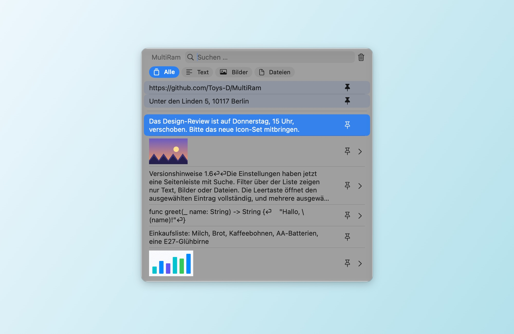
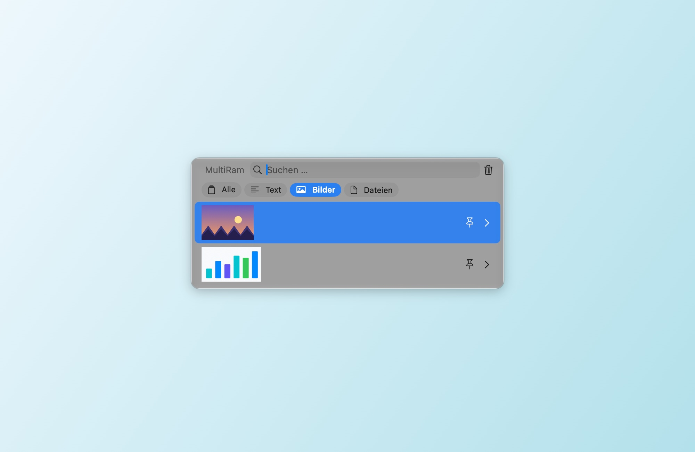
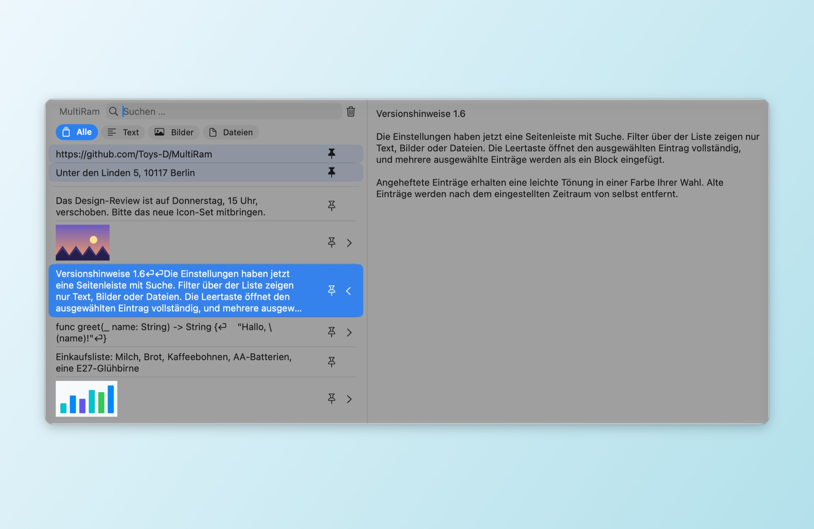
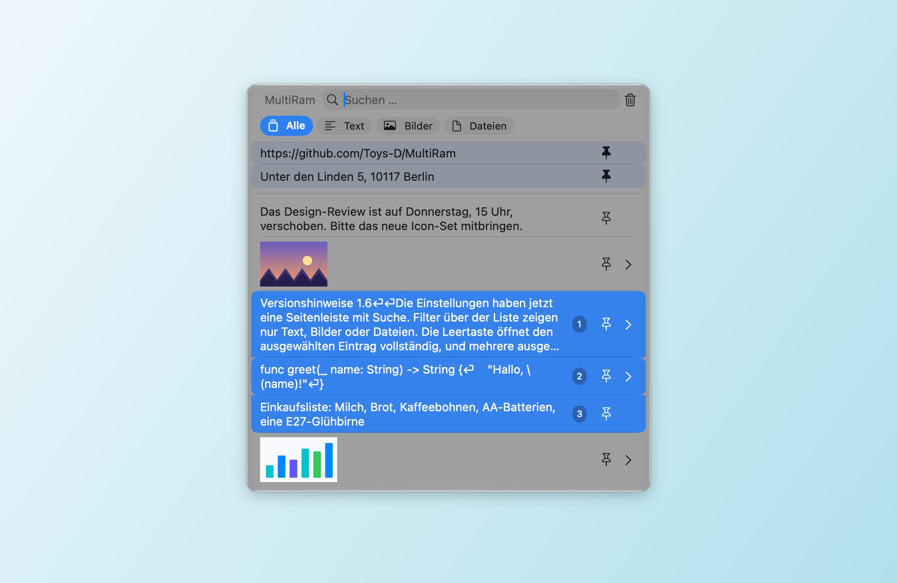
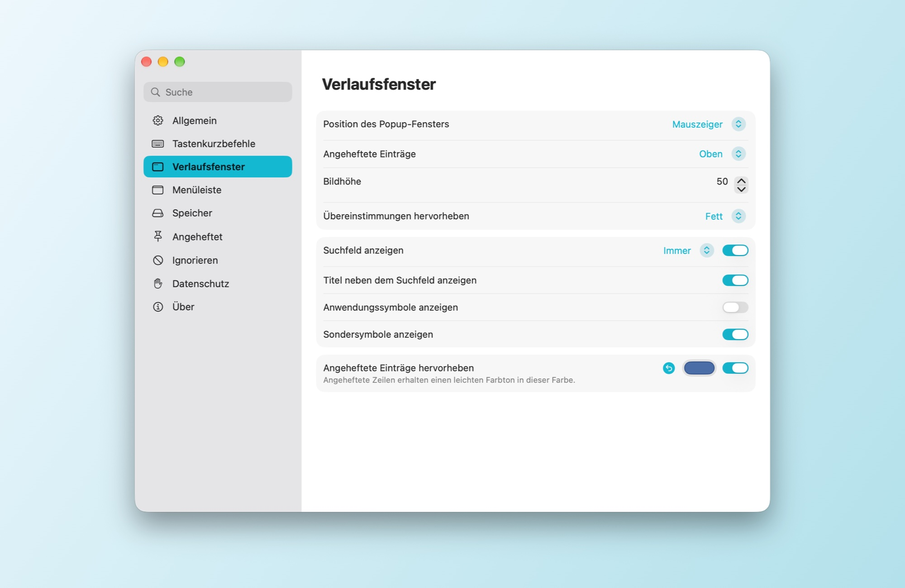
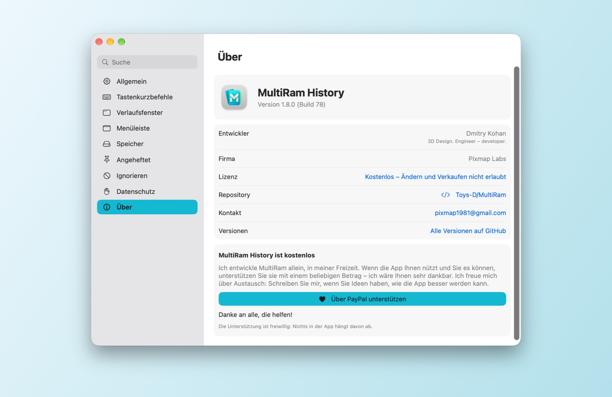

# MultiRam History

[English](README.md) · [Русский](README.md#по-русски) · [Español](README.es.md) · [Français](README.fr.md) · **Deutsch** · [Português](README.pt-BR.md) · [简体中文](README.zh-Hans.md) · [繁體中文](README.zh-Hant.md) · [Українська](README.uk.md)

Ein Verlaufsmanager für die Zwischenablage unter macOS. MultiRam merkt sich die Texte, Bilder und Dateien, die Sie kopieren, findet jeden Eintrag in Sekunden und setzt ihn dort ein, wo Sie gerade arbeiten.

**[MultiRam.dmg herunterladen](https://github.com/Toys-D/MultiRam/releases/latest/download/MultiRam.dmg)** · macOS 14 oder neuer · Intel und Apple Silicon · 9 Sprachen · kostenlos

| | |
|:---:|:---:|
|  |  |
| **Filter:** nur Text, nur Bilder oder nur Dateien | **Vorschau:** Leertaste oder ⌘Y zeigt den ganzen Eintrag |
|  |  |
| **Mehrere als einen einsetzen:** Shift+↓ oder ⌘-Klick, dann Return | **Einstellungen:** Seitenleiste mit Suche, Änderungen wirken sofort |

## Immer griffbereit

Drücken Sie **Option + V**, und der Verlauf öffnet sich direkt am Cursor. Tippen Sie, um zu suchen, drücken Sie **Return**, um den Eintrag in die App einzusetzen, in der Sie gerade gearbeitet haben, oder die **Leertaste**, um ihn vollständig zu sehen. In einem Passwortfeld, in dem macOS Kurzbefehle nur mit Option blockiert, öffnet **Control + Option + V** den Verlauf trotzdem.

## Funktionen

- **Merkt sich alles, was Sie kopieren:** Text, Code, Links, Bilder und Dateien, bis zu der Anzahl an Einträgen, die Sie festlegen.
- **Setzt für Sie ein.** Wählen Sie einen Eintrag, und er landet in der App, in der Sie gearbeitet haben; die Formatierung lässt sich dabei entfernen.
- **Suche** im gesamten Text jedes Eintrags, ohne Unterscheidung von Groß- und Kleinschreibung; im Russischen gelten „ё“ und „е“ als ein Buchstabe.
- **Filter** über der Liste: Alle, Text, Bilder, Dateien.
- **Vorschau.** Leertaste oder ⌘Y öffnet den Eintrag im Seitenbereich: den vollständigen Text oder das Bild in Originalgröße.
- **Bilder in anderen Apps öffnen.** Unter einem Bild im Seitenbereich finden Sie Tasten für die Editoren auf Ihrem Mac: Vorschau, Photoshop, Illustrator und weitere.
- **Anheften.** Heften Sie an, was Sie oft einsetzen; angeheftete Zeilen bleiben oben und sind dezent in einer Farbe Ihrer Wahl getönt.
- **Mehrere Einträge als einen einsetzen.** Wählen Sie sie mit Shift+↑/↓ oder ⌘-Klick aus (Nummern zeigen die Reihenfolge) und drücken Sie Return: Ihr Text wird als ein Block eingesetzt, ein Eintrag pro Zeile.
- **Räumt selbst auf.** Einträge, die älter als einen Tag, eine Woche, einen Monat, drei Monate oder ein Jahr sind, können automatisch entfernt werden; angeheftete bleiben.
- **Ausnahmen.** Ignorieren Sie bestimmte Apps, Datentypen oder Text, der einem Muster entspricht; pausieren Sie die Aufzeichnung mit einem Klick.
- **Updates.** Einmal am Tag fragt MultiRam bei GitHub nach der neuesten Version und bietet deren Downloadseite an. Ihr Verlauf verlässt Ihren Mac nie.
- **In Ihrer Sprache:** Englisch, Spanisch, Französisch, Deutsch, Portugiesisch, Chinesisch (vereinfacht und traditionell), Russisch und Ukrainisch. MultiRam folgt der Systemsprache oder der Sprache, die Sie unter Einstellungen ▸ Allgemein wählen; fehlt Ihre, verwendet MultiRam Englisch.

## Unterstützte Sprachen

MultiRam ist vollständig in neun Sprachen übersetzt:

| Sprache | Auf Deutsch |
|---|---|
| English | Englisch |
| Español | Spanisch |
| Français | Französisch |
| Deutsch | Deutsch |
| Português (Brasil) | Portugiesisch (Brasilien) |
| 简体中文 | Chinesisch (vereinfacht) |
| 繁體中文 | Chinesisch (traditionell) |
| Русский | Russisch |
| Українська | Ukrainisch |

MultiRam folgt der Sprache von macOS oder der, die Sie unter **Einstellungen ▸ Allgemein ▸ Sprache** wählen. Verwendet Ihr Mac eine Sprache, die hier nicht aufgeführt ist, erscheint MultiRam auf Englisch.

## Installation

1. Laden Sie [MultiRam.dmg](https://github.com/Toys-D/MultiRam/releases/latest/download/MultiRam.dmg) herunter, öffnen Sie es und ziehen Sie **MultiRam** in den Ordner „Programme“.
2. Öffnen Sie MultiRam. Beim ersten Mal bittet macOS um Ihre Erlaubnis; siehe unten. Das Symbol erscheint in der Menüleiste.
3. Damit MultiRam für Sie einsetzen kann, aktivieren Sie es unter **Systemeinstellungen ▸ Datenschutz & Sicherheit ▸ Gerätesteuerung und Datenzugriff** (unter macOS 14–26: **Bedienungshilfen**). Sobald der Zugriff aktiv ist, startet MultiRam von selbst neu.

### Warum macOS beim ersten Start um Erlaubnis bittet

Meine Apps gibt es nicht im Mac App Store, und ich zahle Apple nicht die jährliche Entwicklergebühr (99 $), deshalb werden sie von Apple nicht notarisiert. macOS blockiert jede solche App beim ersten Öffnen; über die App selbst sagt das nichts Schlechtes aus. Erlauben Sie sie einmal, danach öffnet sie sich wie jede andere App.

**macOS 15 und neuer:**

1. Doppelklicken Sie im Ordner „Programme“ auf **MultiRam**. macOS meldet, dass die App nicht überprüft werden kann: Klicken Sie auf **Fertig**, nicht auf „In den Papierkorb legen“.
2. Öffnen Sie **Systemeinstellungen ▸ Datenschutz & Sicherheit**.
3. Scrollen Sie nach unten zu **Sicherheit**. Klicken Sie neben der Meldung, dass MultiRam blockiert wurde, auf **Dennoch öffnen** (die Taste bleibt nach dem Versuch etwa eine Stunde lang dort).
4. Bestätigen Sie mit Ihrem Passwort oder Touch ID und klicken Sie noch einmal auf **Dennoch öffnen**.

macOS merkt sich diese Entscheidung. Updates sind auf dieselbe Weise signiert und behalten daher sowohl diese Entscheidung als auch die Berechtigung zum Einsetzen.

**Oder im Terminal**, unter jeder Version: `xattr -dr com.apple.quarantine "/Applications/MultiRam.app"` entfernt die Markierung „aus dem Internet geladen“, und MultiRam öffnet sich ohne Warnung.

## Bedienung

- **Öffnen:** Option + V, in Passwortfeldern Control + Option + V, oder das MultiRam-Symbol in der Menüleiste ▸ Verlauf anzeigen. Beide Kurzbefehle lassen sich unter Einstellungen ▸ Tastenkurzbefehle ändern.
- **Einsetzen:** Klicken Sie auf einen Eintrag oder drücken Sie Return. ⌥ kopiert nur, ohne einzusetzen, ⇧⌘ setzt ohne Formatierung ein.
- **Finden:** Einfach lostippen. Die Filter über der Liste beschränken sie auf Text, Bilder oder Dateien.
- **Ansehen:** Leertaste (bei leerem Suchfeld) oder ⌘Y, oder der Pfeil am rechten Rand einer Zeile.
- **Anheften:** die Stecknadel-Taste in einer Zeile oder ⌥P. Einen Eintrag löschen Sie mit ⌥⌫.
- **Mehrere auf einmal:** Shift+↑/↓ oder ⌘-Klick, dann Return.
- **Einstellungen:** ⌘, im Verlaufsfenster oder das Symbol in der Menüleiste ▸ Einstellungen. Die Bereiche links: Allgemein, Tastenkurzbefehle, Verlaufsfenster, Menüleiste, Speicher, Angeheftet, Ignorieren, Datenschutz und Über.

## Projekt unterstützen

MultiRam History ist kostenlos. Ich entwickle es allein, in meiner Freizeit, weil Kopieren und Einsetzen auf dem Mac einen ordentlichen Verlauf verdient. Wenn es Ihnen nützt und Sie es sich leisten können, unterstützen Sie es mit einem beliebigen Betrag: So kann ich mehr Zeit hineinstecken. Ich wäre Ihnen sehr dankbar.

**[Über PayPal unterstützen](https://www.paypal.com/cgi-bin/webscr?cmd=_xclick&business=pixmap1981%40gmail.com&item_name=MultiRam+History&currency_code=USD)** · pixmap1981@gmail.com · Die Unterstützung ist freiwillig; in der App hängt nichts davon ab.

## Kontakt

Fehler, Fragen, Ideen: **[pixmap1981@gmail.com](mailto:pixmap1981@gmail.com?subject=MultiRam%20History)**, oder eröffnen Sie ein [Issue](https://github.com/Toys-D/MultiRam/issues). Ich freue mich über jedes Gespräch und jeden Hinweis, wie sich die App verbessern lässt.

## Aus dem Quellcode erstellen

Öffnen Sie `MultiRam.xcodeproj` in Xcode 16 oder neuer und führen Sie das Schema **MultiRam** aus. Tests: `xcodebuild -project MultiRam.xcodeproj -scheme MultiRam -testPlan MultiRam -destination 'platform=macOS' test`. Das Release-DMG wird mit `scripts/package-release.py` erstellt; siehe [docs/release.md](docs/release.md).

## Lizenz

MultiRam History ist kostenlos: Sie dürfen es zu Hause und bei der Arbeit nutzen und das Original-DMG weitergeben. Ändern, Reverse Engineering und Verkaufen sind nicht erlaubt. Teile davon basieren auf [Maccy](https://github.com/p0deje/Maccy) von Alex Rodionov und werden unter der MIT-Lizenz verwendet. Siehe [LICENSE](LICENSE).

**Dmitry Kohan · Toys-D · Pixmap Labs**
