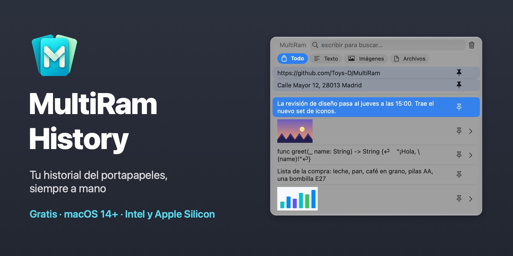
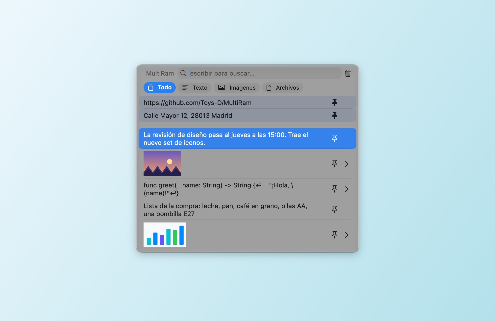
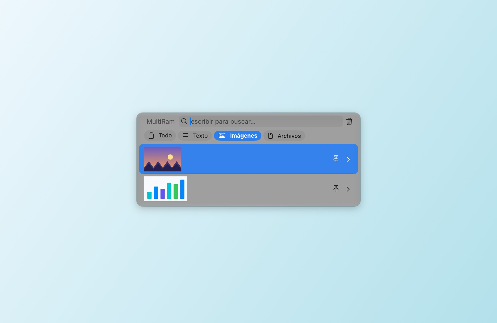
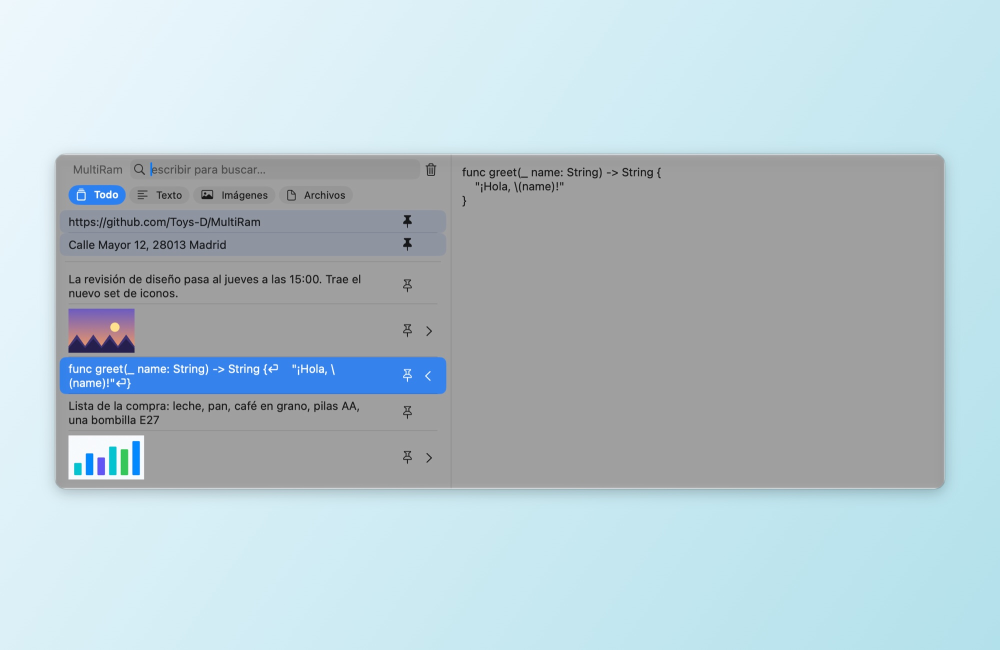
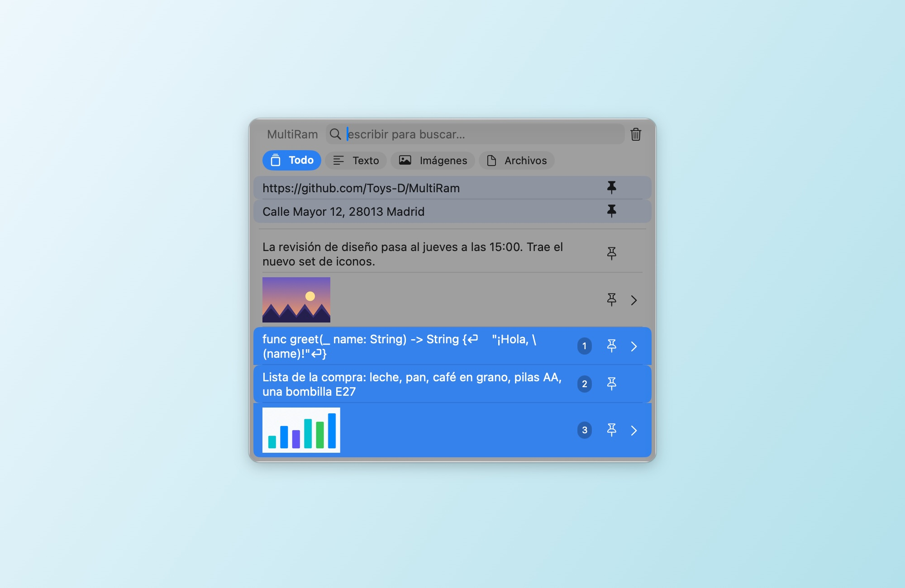
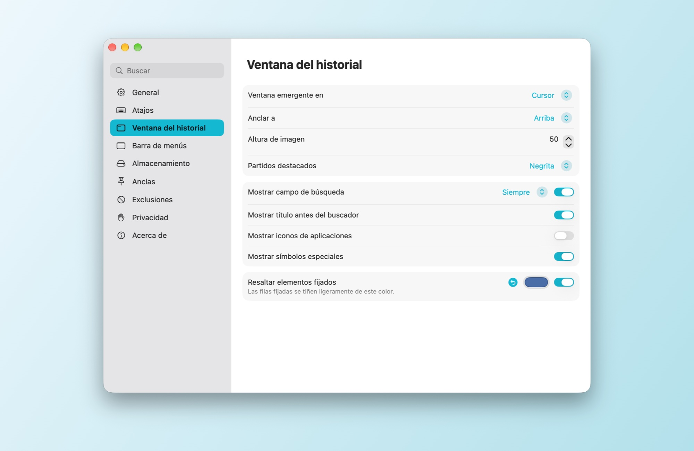
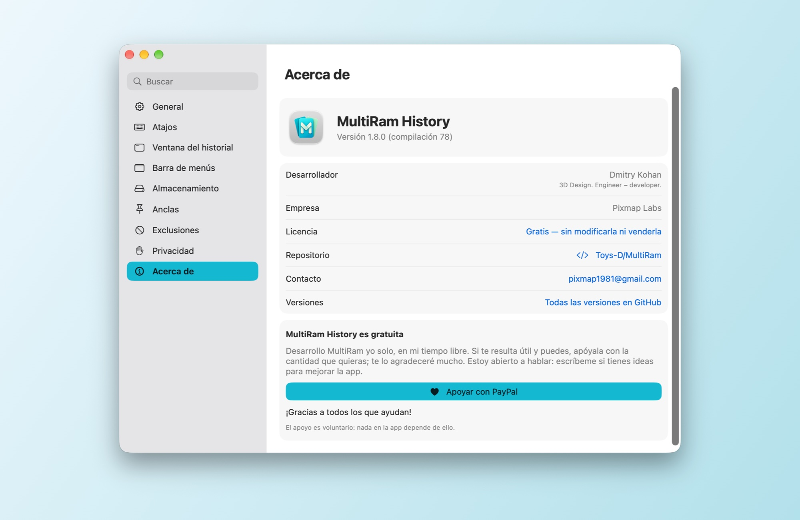

# MultiRam History

[English](README.md) · [Русский](README.md#по-русски) · **Español** · [Français](README.fr.md) · [Deutsch](README.de.md) · [Português](README.pt-BR.md) · [简体中文](README.zh-Hans.md) · [繁體中文](README.zh-Hant.md) · [Українська](README.uk.md)

Un gestor del historial del portapapeles para macOS. MultiRam guarda los textos, las imágenes y los archivos que copias, encuentra cualquiera de ellos en un segundo y lo vuelve a pegar donde estás trabajando.

**[Descargar MultiRam.dmg](https://github.com/Toys-D/MultiRam/releases/latest/download/MultiRam.dmg)** · macOS 14 o posterior · Intel y Apple Silicon · 9 idiomas · gratis

| | |
|:---:|:---:|
|  |  |
| **Filtros:** solo texto, solo imágenes o solo archivos | **Vista previa:** Espacio o ⌘Y muestra el elemento completo |
|  |  |
| **Pegar varios como uno:** Mayúsculas+↓ o ⌘-clic y luego Retorno | **Ajustes:** barra lateral con búsqueda, cambios al instante |

## Siempre a mano

Pulsa **Opción + V** y el historial se abre justo junto al cursor. Escribe para buscar, pulsa **Retorno** para pegar el elemento en la app en la que estabas trabajando o pulsa **Espacio** para verlo completo. En un campo de contraseña, donde macOS bloquea los atajos que solo usan Opción, **Control + Opción + V** lo abre igualmente.

## Qué hace

- **Recuerda todo lo que copias:** texto, código, enlaces, imágenes y archivos, hasta el número de elementos que elijas.
- **Pega por ti.** Elige un elemento y aparece en la app en la que estabas trabajando; si quieres, sin formato.
- **Búsqueda** en el texto completo de cada elemento, sin distinguir mayúsculas de minúsculas; en ruso, «ё» y «е» cuentan como una sola letra.
- **Filtros** encima de la lista: Todo, Texto, Imágenes, Archivos.
- **Vista previa.** Espacio o ⌘Y abre el elemento en un panel lateral: el texto completo o la imagen a su tamaño real.
- **Abre imágenes en otras apps.** Debajo de la imagen, en el panel lateral, hay botones para los editores que haya en tu Mac: Vista Previa, Photoshop, Illustrator y otros.
- **Fijados.** Fija lo que pegas a menudo: las filas fijadas se quedan arriba, con un ligero tono del color que elijas.
- **Pega varios elementos como uno.** Selecciónalos con Mayúsculas+↑/↓ o ⌘-clic (los números indican el orden) y pulsa Retorno: su texto se pega como un solo bloque, un elemento por línea.
- **Se ordena solo.** Los elementos de más de un día, una semana, un mes, tres meses o un año pueden eliminarse automáticamente; los fijados se quedan.
- **Exclusiones.** Ignora las apps, los tipos de datos o el texto que coincida con un patrón que elijas; pausa el registro con un clic.
- **Actualizaciones.** Una vez al día, MultiRam consulta en GitHub cuál es la última versión y te ofrece su página de descarga. Tu historial nunca sale de tu Mac.
- **En tu idioma:** inglés, español, francés, alemán, portugués, chino (simplificado y tradicional), ruso y ucraniano. MultiRam usa el idioma del sistema o el que elijas en Ajustes ▸ General; si no tiene el tuyo, usa el inglés.

## Idiomas disponibles

MultiRam está traducido por completo a nueve idiomas:

| Idioma | En español |
|---|---|
| English | Inglés |
| Español | Español |
| Français | Francés |
| Deutsch | Alemán |
| Português (Brasil) | Portugués (Brasil) |
| 简体中文 | Chino (simplificado) |
| 繁體中文 | Chino (tradicional) |
| Русский | Ruso |
| Українська | Ucraniano |

Usa el idioma de macOS o el que elijas en **Ajustes ▸ General ▸ Idioma**. Si tu Mac usa un idioma que no está en la lista, MultiRam aparece en inglés.

## Instalación

1. Descarga [MultiRam.dmg](https://github.com/Toys-D/MultiRam/releases/latest/download/MultiRam.dmg), ábrelo y arrastra **MultiRam** a Aplicaciones.
2. Abre MultiRam. La primera vez, macOS te pide permiso (lo explico más abajo). El icono aparece en la barra de menús.
3. Para que MultiRam pueda pegar por ti, actívalo en **Ajustes del Sistema ▸ Privacidad y seguridad ▸ Control de dispositivos y acceso a datos** (en macOS 14–26: **Accesibilidad**). MultiRam se reinicia solo en cuanto el acceso está activado.

### Por qué macOS pide permiso la primera vez

Mis apps no están en la Mac App Store y no pago la cuota anual de desarrollador de Apple (99 USD), así que Apple no las notariza. macOS bloquea cualquier app así la primera vez que se abre; eso no dice nada malo de la app en sí. Permítela una vez y, a partir de entonces, se abrirá como cualquier otra.

**macOS 15 y posterior:**

1. Haz doble clic en **MultiRam** en Aplicaciones. macOS dice que no puede verificar la app: pulsa **Aceptar**, no «Trasladar a la Papelera».
2. Abre **Ajustes del Sistema ▸ Privacidad y seguridad**.
3. Desplázate hasta **Seguridad**. Junto al mensaje de que MultiRam se ha bloqueado, pulsa **Abrir igualmente** (el botón sigue ahí durante una hora, más o menos, después del intento).
4. Confirma con tu contraseña o Touch ID y vuelve a pulsar **Abrir igualmente**.

macOS recuerda la elección. Las actualizaciones se firman de la misma manera, así que conservan tanto esta elección como el permiso para pegar.

**O en Terminal**, en cualquier versión: `xattr -dr com.apple.quarantine "/Applications/MultiRam.app"` quita la marca de «descargado de internet» y MultiRam se abre sin el aviso.

## Cómo se usa

- **Abrir:** Opción + V, o Control + Opción + V en los campos de contraseña, o el icono de MultiRam en la barra de menús ▸ Mostrar historial. Puedes cambiar ambos atajos en Ajustes ▸ Atajos.
- **Pegar:** haz clic en un elemento o pulsa Retorno. ⌥ copia sin pegar; ⇧⌘ pega sin formato.
- **Buscar:** basta con escribir. Los filtros encima de la lista la reducen a texto, imágenes o archivos.
- **Ver:** Espacio (con la búsqueda vacía) o ⌘Y, o la flecha del borde derecho de una fila.
- **Fijar:** el botón de fijar de una fila o ⌥P. Para eliminar un elemento, ⌥⌫.
- **Varios a la vez:** Mayúsculas+↑/↓ o ⌘-clic y luego Retorno.
- **Ajustes:** ⌘, en la ventana del historial, o el icono de la barra de menús ▸ Ajustes. Secciones a la izquierda: General, Atajos, Ventana del historial, Barra de menús, Almacenamiento, Anclas, Exclusiones, Privacidad y Acerca de.

## Apoya el proyecto

MultiRam History es gratis. Lo hago yo solo, en mi tiempo libre, porque copiar y pegar en un Mac merece un historial como es debido. Si te resulta útil y puedes, apóyalo con la cantidad que quieras: eso me permite dedicarle más tiempo. Te lo agradeceré de verdad.

**[Apoyar con PayPal](https://www.paypal.com/cgi-bin/webscr?cmd=_xclick&business=pixmap1981%40gmail.com&item_name=MultiRam+History&currency_code=USD)** · pixmap1981@gmail.com · El apoyo es voluntario; nada en la app depende de él.

## Contacto

Errores, preguntas, ideas: **[pixmap1981@gmail.com](mailto:pixmap1981@gmail.com?subject=MultiRam%20History)**, o abre un [issue](https://github.com/Toys-D/MultiRam/issues). Estoy abierto a hablar y siempre me alegra saber cómo mejorar la app.

## Compilar desde el código fuente

Abre `MultiRam.xcodeproj` en Xcode 16 o posterior y ejecuta el esquema **MultiRam**. Pruebas: `xcodebuild -project MultiRam.xcodeproj -scheme MultiRam -testPlan MultiRam -destination 'platform=macOS' test`. El DMG de la versión se genera con `scripts/package-release.py`; consulta [docs/release.md](docs/release.md).

## Licencia

MultiRam History es gratis: úsalo en casa y en el trabajo, y comparte el DMG original. No está permitido modificarlo, aplicarle ingeniería inversa ni venderlo. Partes de la app se basan en [Maccy](https://github.com/p0deje/Maccy), de Alex Rodionov, y se usan bajo la licencia MIT. Consulta [LICENSE](LICENSE).

**Dmitry Kohan · Toys-D · Pixmap Labs**
