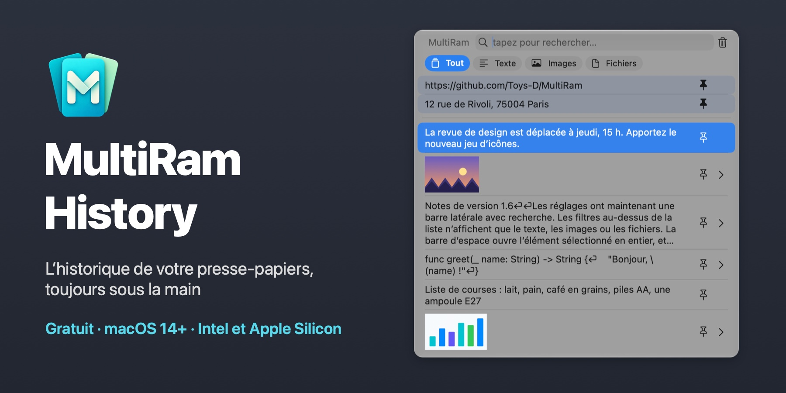
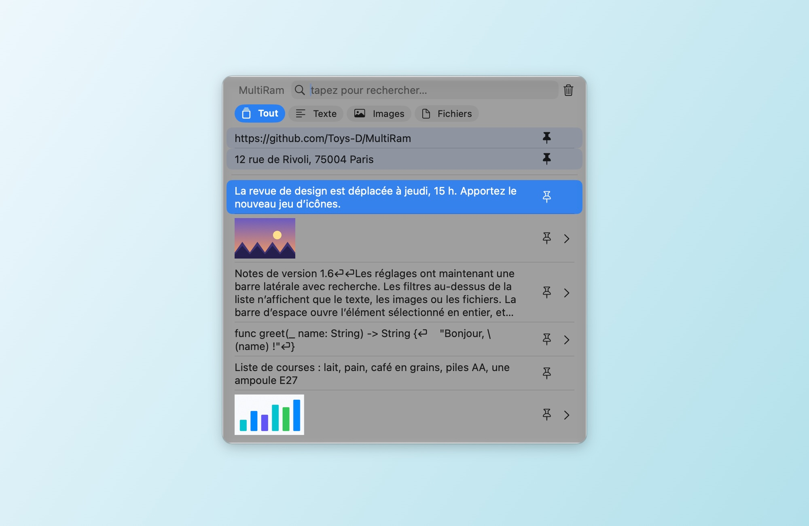
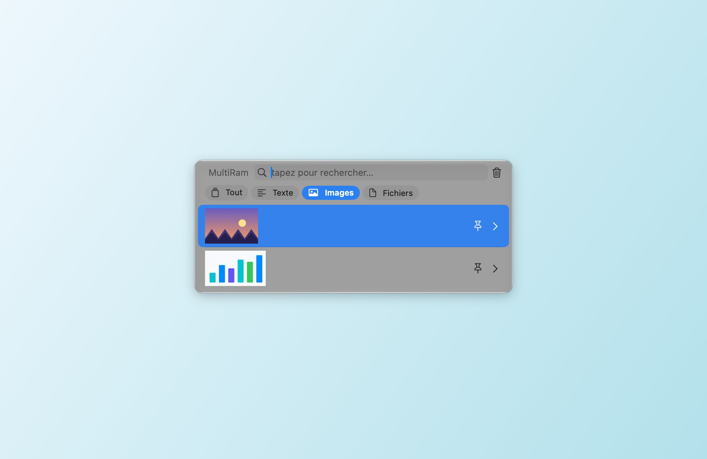
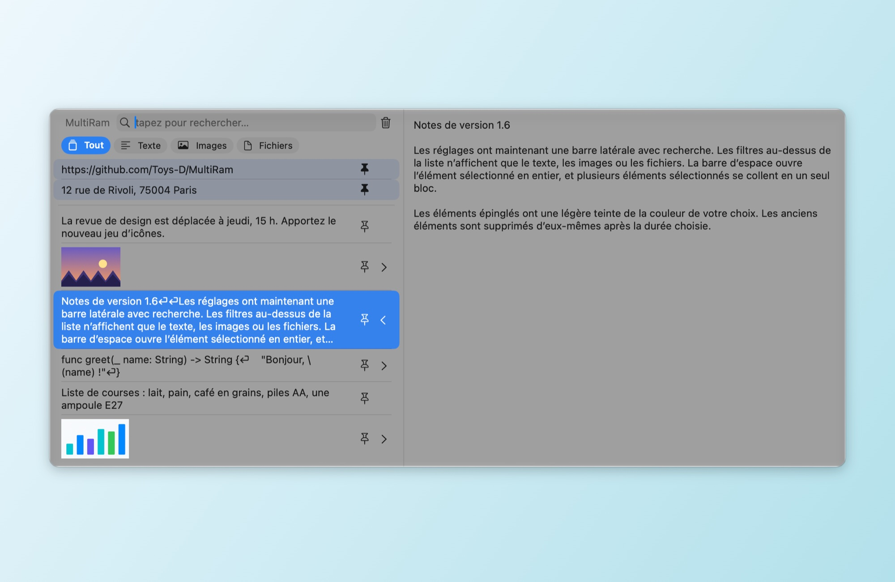
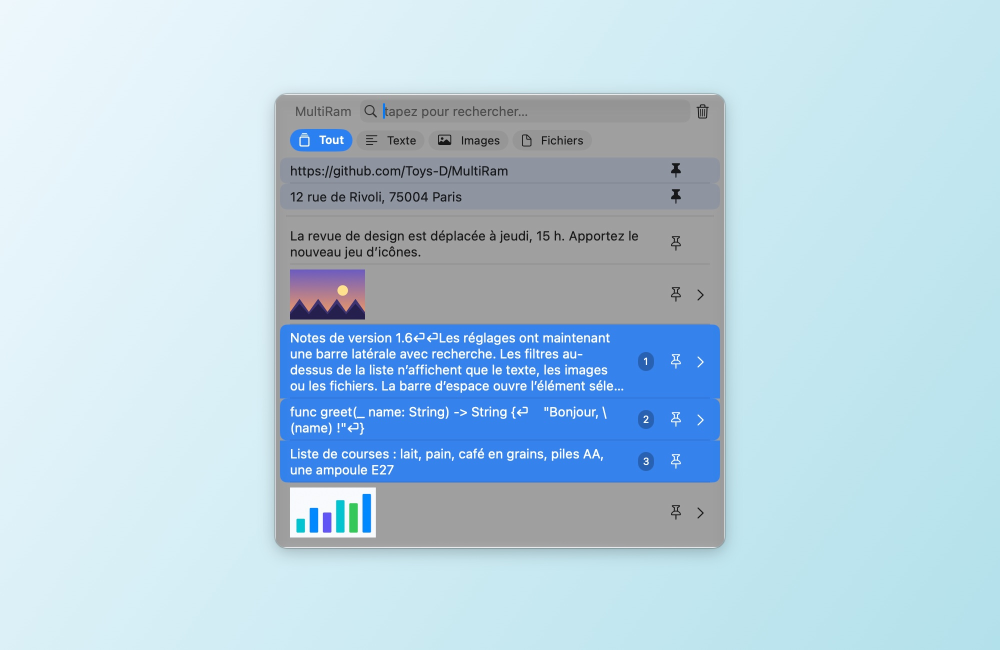
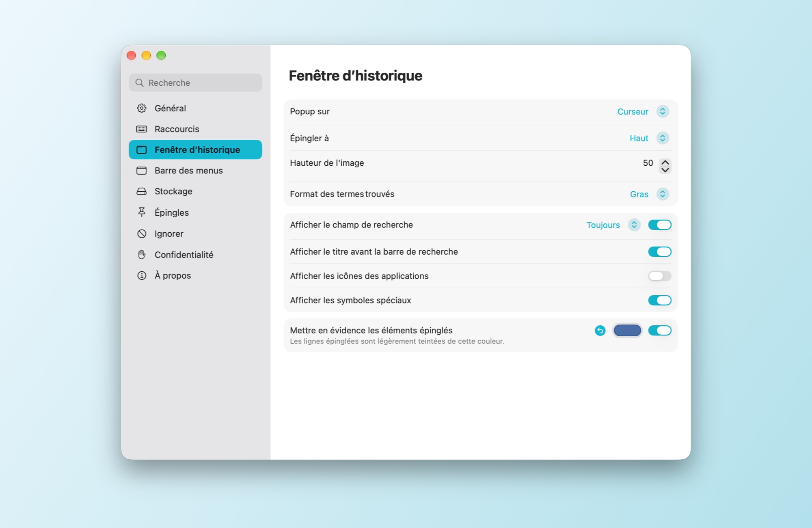
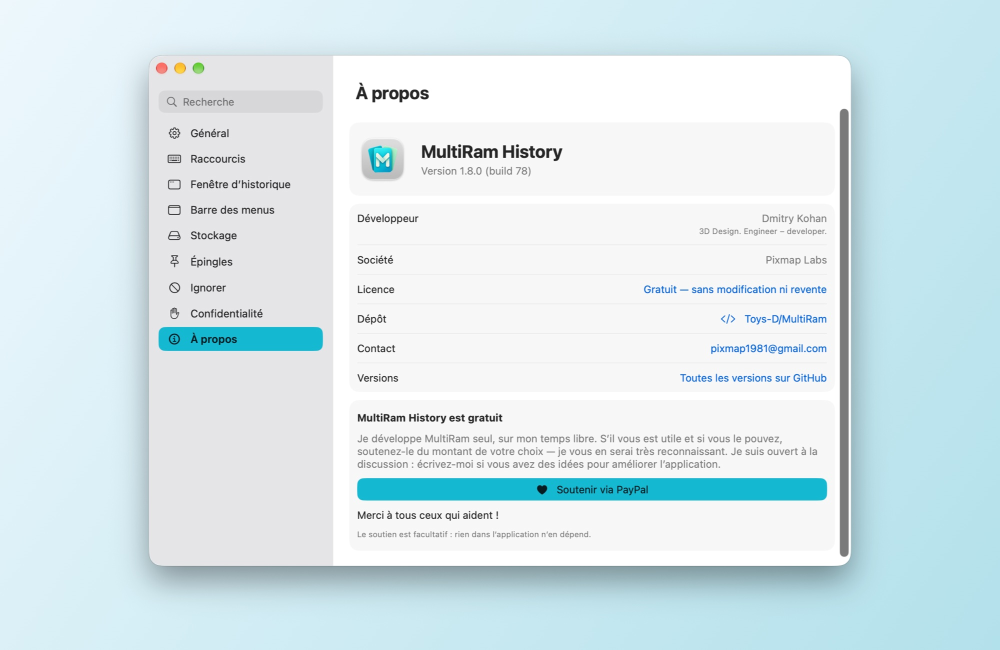

# MultiRam History

[English](README.md) · [Русский](README.md#по-русски) · [Español](README.es.md) · **Français** · [Deutsch](README.de.md) · [Português](README.pt-BR.md) · [简体中文](README.zh-Hans.md) · [繁體中文](README.zh-Hant.md) · [Українська](README.uk.md)

Un gestionnaire d’historique du presse-papiers pour macOS. MultiRam garde les textes, les images et les fichiers que vous copiez, retrouve n’importe lequel en une seconde et le colle là où vous travaillez.

**[Télécharger MultiRam.dmg](https://github.com/Toys-D/MultiRam/releases/latest/download/MultiRam.dmg)** · macOS 14 ou ultérieur · Intel et Apple Silicon · 9 langues · gratuit

| | |
|:---:|:---:|
|  |  |
| **Filtres :** seulement le texte, les images ou les fichiers | **Aperçu :** Espace ou ⌘Y affiche l’élément en entier |
|  |  |
| **Coller plusieurs éléments en un :** Maj+↓ ou ⌘-clic, puis Retour | **Réglages :** une barre latérale avec recherche, changements immédiats |

## Toujours sous la main

Appuyez sur **Option + V** et l’historique s’ouvre juste à côté du curseur. Tapez pour chercher, appuyez sur **Retour** pour coller l’élément dans l’app où vous travailliez, ou sur **Espace** pour le voir en entier. Dans un champ de mot de passe, où macOS bloque les raccourcis utilisant uniquement Option, **Contrôle + Option + V** l’ouvre quand même.

## Ce qu’il fait

- **Retient tout ce que vous copiez :** texte, code, liens, images et fichiers, jusqu’au nombre d’éléments que vous choisissez.
- **Colle à votre place.** Choisissez un élément et il arrive dans l’app où vous travailliez ; la mise en forme peut être retirée au passage.
- **Recherche** dans le texte entier de chaque élément, sans tenir compte de la casse ; en russe, « ё » et « е » comptent comme une seule lettre.
- **Filtres** au-dessus de la liste : Tout, Texte, Images, Fichiers.
- **Aperçu.** Espace ou ⌘Y ouvre l’élément dans un panneau latéral : le texte entier, ou l’image à sa taille réelle.
- **Ouvrir les images dans d’autres apps.** Sous une image, dans le panneau latéral, des boutons ouvrent les éditeurs présents sur votre Mac : Aperçu, Photoshop, Illustrator et d’autres.
- **Épingles.** Épinglez ce que vous collez souvent ; les lignes épinglées restent en haut, légèrement teintées de la couleur de votre choix.
- **Coller plusieurs éléments en un.** Sélectionnez-les avec Maj+↑/↓ ou ⌘-clic (des numéros indiquent l’ordre) et appuyez sur Retour : leur texte est collé en un seul bloc, un élément par ligne.
- **Fait le ménage tout seul.** Les éléments de plus d’un jour, d’une semaine, d’un mois, de trois mois ou d’un an peuvent être supprimés automatiquement ; les éléments épinglés restent.
- **Exclusions.** Ignorez les apps, les types de données ou le texte correspondant à un motif de votre choix ; mettez l’enregistrement en pause d’un clic.
- **Mises à jour.** Une fois par jour, MultiRam demande à GitHub la dernière version publiée et vous propose sa page de téléchargement. Votre historique ne quitte jamais votre Mac.
- **Dans votre langue :** anglais, espagnol, français, allemand, portugais, chinois (simplifié et traditionnel), russe et ukrainien. MultiRam suit la langue du système, ou celle que vous choisissez dans Réglages ▸ Général ; s’il ne dispose pas de la vôtre, il utilise l’anglais.

## Langues disponibles

MultiRam est entièrement traduit en neuf langues :

| Langue | En français |
|---|---|
| English | Anglais |
| Español | Espagnol |
| Français | Français |
| Deutsch | Allemand |
| Português (Brasil) | Portugais (Brésil) |
| 简体中文 | Chinois (simplifié) |
| 繁體中文 | Chinois (traditionnel) |
| Русский | Russe |
| Українська | Ukrainien |

Il suit la langue de macOS, ou celle que vous choisissez dans **Réglages ▸ Général ▸ Langue**. Si votre Mac utilise une langue absente de cette liste, MultiRam s’affiche en anglais.

## Installation

1. Téléchargez [MultiRam.dmg](https://github.com/Toys-D/MultiRam/releases/latest/download/MultiRam.dmg), ouvrez-le et faites glisser **MultiRam** dans Applications.
2. Ouvrez MultiRam. La première fois, macOS vous demande votre autorisation (voir plus bas). L’icône apparaît dans la barre des menus.
3. Pour que MultiRam puisse coller à votre place, activez-le dans **Réglages Système ▸ Confidentialité et sécurité ▸ Contrôle de l’appareil et accès aux données** (sous macOS 14–26 : **Accessibilité**). MultiRam redémarre tout seul dès que l’accès est activé.

### Pourquoi macOS demande une autorisation au premier lancement

Mes apps ne sont pas sur le Mac App Store, et je ne paie pas la cotisation annuelle de développeur d’Apple (99 $), donc Apple ne les notarie pas. macOS bloque toutes les apps de ce type à leur première ouverture ; cela ne dit rien de mal sur l’app elle-même. Autorisez-la une fois, et elle s’ouvrira ensuite comme n’importe quelle autre app.

**macOS 15 et ultérieur :**

1. Double-cliquez sur **MultiRam** dans Applications. macOS indique qu’il ne peut pas vérifier l’app : cliquez sur **Terminé**, pas sur « Placer dans la corbeille ».
2. Ouvrez **Réglages Système ▸ Confidentialité et sécurité**.
3. Faites défiler jusqu’à **Sécurité**. À côté du message indiquant que MultiRam a été bloqué, cliquez sur **Ouvrir quand même** (le bouton reste affiché environ une heure après la tentative).
4. Confirmez avec votre mot de passe ou Touch ID, puis cliquez encore une fois sur **Ouvrir quand même**.

macOS retient ce choix. Les mises à jour sont signées de la même façon : elles conservent donc ce choix et l’autorisation de coller.

**Ou dans Terminal**, sur n’importe quelle version : `xattr -dr com.apple.quarantine "/Applications/MultiRam.app"` retire la marque « téléchargé depuis Internet », et MultiRam s’ouvre sans avertissement.

## Utilisation

- **Ouvrir :** Option + V, ou Contrôle + Option + V dans les champs de mot de passe, ou l’icône MultiRam dans la barre des menus ▸ Afficher l’historique. Les deux raccourcis se modifient dans Réglages ▸ Raccourcis.
- **Coller :** cliquez sur un élément ou appuyez sur Retour. ⌥ copie sans coller, ⇧⌘ colle sans mise en forme.
- **Chercher :** tapez, tout simplement. Les filtres au-dessus de la liste la limitent au texte, aux images ou aux fichiers.
- **Voir :** Espace (avec une recherche vide) ou ⌘Y, ou la flèche au bord droit d’une ligne.
- **Épingler :** le bouton d’épingle d’une ligne ou ⌥P. Supprimez un élément avec ⌥⌫.
- **Plusieurs à la fois :** Maj+↑/↓ ou ⌘-clic, puis Retour.
- **Réglages :** ⌘, dans la fenêtre d’historique, ou l’icône de la barre des menus ▸ Réglages. Sections à gauche : Général, Raccourcis, Fenêtre d’historique, Barre des menus, Stockage, Épingles, Ignorer, Confidentialité et À propos.

## Soutenir le projet

MultiRam History est gratuit. Je le développe seul, sur mon temps libre, parce que copier-coller sur un Mac mérite un vrai historique. S’il vous est utile et que vous le pouvez, soutenez-le du montant de votre choix : c’est ce qui me permet d’y consacrer davantage de temps. Je vous en serai très reconnaissant.

**[Soutenir via PayPal](https://www.paypal.com/cgi-bin/webscr?cmd=_xclick&business=pixmap1981%40gmail.com&item_name=MultiRam+History&currency_code=USD)** · pixmap1981@gmail.com · Le soutien est facultatif ; rien dans l’app n’en dépend.

## Me contacter

Bugs, questions, idées : **[pixmap1981@gmail.com](mailto:pixmap1981@gmail.com?subject=MultiRam%20History)**, ou ouvrez une [issue](https://github.com/Toys-D/MultiRam/issues). Je suis ouvert à la discussion et toujours content d’apprendre comment améliorer l’app.

## Compiler depuis les sources

Ouvrez `MultiRam.xcodeproj` dans Xcode 16 ou ultérieur et lancez le schéma **MultiRam**. Tests : `xcodebuild -project MultiRam.xcodeproj -scheme MultiRam -testPlan MultiRam -destination 'platform=macOS' test`. Le DMG de la version se construit avec `scripts/package-release.py` ; voir [docs/release.md](docs/release.md).

## Licence

MultiRam History est gratuit : utilisez-le à la maison comme au travail, et partagez le DMG original. Il est interdit de le modifier, d’en faire l’ingénierie inverse et de le vendre. Certaines parties s’appuient sur [Maccy](https://github.com/p0deje/Maccy) d’Alex Rodionov, utilisé sous licence MIT. Voir [LICENSE](LICENSE).

**Dmitry Kohan · Toys-D · Pixmap Labs**
