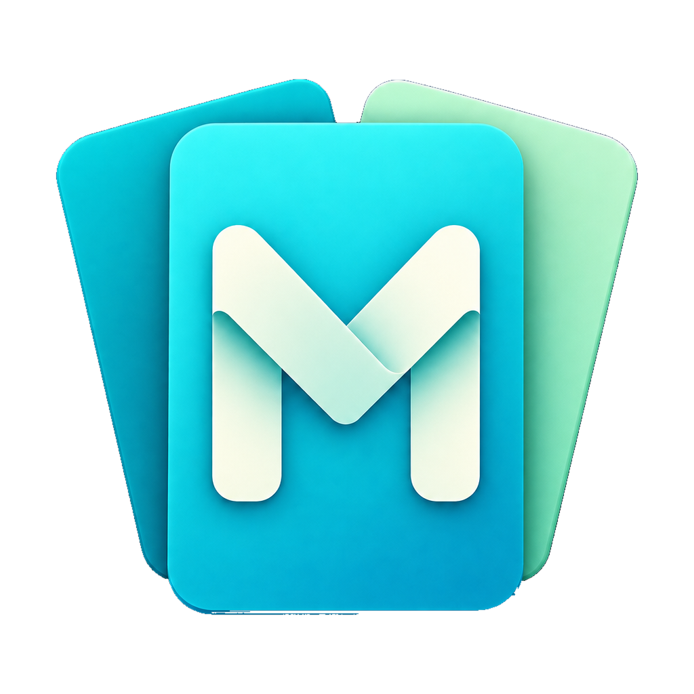

# MultiRam History

### [⬇ Download the latest MultiRam for macOS](https://github.com/Toys-D/MultiRam/releases/latest/download/MultiRam.dmg)

The newest release as a DMG: open it and drag MultiRam to Applications. macOS 14 or later, Intel and Apple Silicon. Release notes and earlier versions are on the [Releases](https://github.com/Toys-D/MultiRam/releases/latest) page.

[English](#english) · [Русский](#русский)

## English

MultiRam History is a lightweight clipboard history manager for macOS. It keeps the texts, images and files you copy, helps you find the one you need and paste it again.

### Features

- **Option + V** opens the history. The shortcut can be changed in Settings.
- **Control + Option + V** is a fallback that also works in password fields, where macOS withholds Option-only shortcuts while Secure Event Input is on. While that happens, the menu bar icon shows a lock and its tooltip names the app that turned Secure Event Input on.
- Pick an item to paste it into the app you were working in.
- The arrow at the right edge of a row opens the whole item in a side panel: the full text, or the image at its natural size.
- Under an image in the side panel, **Open in…** buttons list the image editors and viewers found on your Mac (Preview, Photoshop, Illustrator and others). The app receives a read-only copy with the original bytes.
- Search the history and pin items with the **PIN** button in the row.
- Text wraps to four lines; longer items end with an ellipsis.
- Settings, About and Quit are in the menu bar icon menu.
- The window stays on screen, also when it opens near the bottom edge.

### Automatic pasting

To paste for you, MultiRam needs the macOS permission to control the computer:

- macOS 27: System Settings → Privacy & Security → **Device Control and Data Access**
- macOS 14–26: System Settings → Privacy & Security → **Accessibility**

Turn MultiRam on in that list. macOS applies the permission only to a newly started process, so MultiRam restarts by itself as soon as access is on. Releases are signed with the same certificate, so updates keep the permission.

### Install

1. Download [MultiRam.dmg](https://github.com/Toys-D/MultiRam/releases/latest/download/MultiRam.dmg).
2. Open it and drag MultiRam to Applications, replacing the old copy.
3. Open MultiRam from Applications. Its icon appears in the menu bar.

#### Why macOS asks for permission on the first launch

My apps are not in the Mac App Store, and I don't pay Apple's yearly developer fee ($99), so Apple does not sign or notarize them. macOS blocks every such app the first time it is opened — this says nothing bad about the app itself. Allow it once, and from then on it opens like any other app.

**macOS 15 and later:**

1. Double-click **MultiRam** in Applications. macOS says it cannot verify the app — press **Done**, not "Move to Trash".
2. Open **System Settings ▸ Privacy & Security**.
3. Scroll down to **Security**. Next to the message that MultiRam was blocked, press **Open Anyway** (the button stays there for about an hour after the attempt).
4. Confirm with your password or Touch ID and press **Open Anyway** once more.

macOS remembers the choice: this copy of MultiRam opens by itself from now on. A newer version downloaded later is allowed the same way.

**macOS 14 and earlier:** right-click (or Control-click) MultiRam in Applications, choose **Open**, then press **Open** in the dialog.

**Or in Terminal**, on any version: `xattr -dr com.apple.quarantine "/Applications/MultiRam.app"` — this removes the "downloaded from the internet" mark, and MultiRam opens without the warning.

### Build from source

Open `MultiRam.xcodeproj` in Xcode and run the **MultiRam** scheme, or:

```sh
xcodebuild -project MultiRam.xcodeproj -scheme MultiRam \
  -configuration Debug -derivedDataPath .build/DerivedData build
open .build/DerivedData/Build/Products/Debug/MultiRam.app
```

Tests:

```sh
xcodebuild -project MultiRam.xcodeproj -scheme MultiRam \
  -testPlan MultiRam -destination 'platform=macOS' test
```

A universal release (`.app`, `.app.zip`, `.dmg`) is built with `scripts/package-release.py`; the steps are in [docs/release.md](docs/release.md).

### Data

Bundle identifier: `local.multiram.MultiRam`. The history is stored in `Application Support/MultiRam/Storage.sqlite` inside the app container; settings live in its UserDefaults domain. Nothing leaves your Mac, and automatic updates are off.

### Author

Dmitry Kohan, Pixmap Labs — 3D Design. Engineer – developer.
[pixmap1981@gmail.com](mailto:pixmap1981@gmail.com) · [github.com/Toys-D](https://github.com/Toys-D)

MIT License, see [LICENSE](LICENSE).

## Русский

MultiRam History — лёгкий менеджер истории буфера обмена для macOS. Хранит скопированные тексты, изображения и файлы, помогает найти нужную запись и вставить её снова.

### Возможности

- **Option + V** открывает историю. Сочетание можно изменить в настройках.
- **Control + Option + V** — запасное сочетание. Оно работает и в полях паролей, где macOS не пропускает сочетания только с Option, пока включён защищённый ввод. В это время на значке в строке меню появляется замочек, а подсказка называет программу, которая включила защищённый ввод.
- Выбранная запись вставляется в программу, в которой вы работали.
- Стрелка у правого края строки открывает запись целиком в боковой панели: полный текст или картинку в натуральную величину.
- Под картинкой в боковой панели — кнопки **«Открыть в…»** для графических редакторов и просмотрщиков, найденных на Mac (Просмотр, Photoshop, Illustrator и другие). Программе передаётся копия с исходными байтами, доступная только для чтения.
- Поиск по истории и закрепление записей кнопкой **PIN** прямо в строке.
- Текст переносится до четырёх строк; длинные записи заканчиваются многоточием.
- Настройки, «О программе» и выход — в меню значка в строке меню.
- Окно остаётся в пределах экрана, в том числе при открытии у нижнего края.

### Автоматическая вставка

Чтобы вставлять за вас, MultiRam нужно разрешение macOS на управление компьютером:

- macOS 27: «Системные настройки → Конфиденциальность и безопасность → **Управление устройством и доступ к данным**»
- macOS 14–26: «Системные настройки → Конфиденциальность и безопасность → **Универсальный доступ**»

Включите MultiRam в этом списке. macOS применяет разрешение только к новому процессу, поэтому MultiRam перезапускается сам, как только доступ включён. Релизы подписаны одним сертификатом, поэтому при обновлениях разрешение сохраняется.

### Установка

1. Скачайте [MultiRam.dmg](https://github.com/Toys-D/MultiRam/releases/latest/download/MultiRam.dmg).
2. Откройте его и перетащите MultiRam в «Программы» с заменой.
3. Запустите MultiRam из «Программ». Значок появится в строке меню.

#### Почему macOS спрашивает разрешение при первом запуске

Моих программ нет в Mac App Store, и я не плачу Apple ежегодный взнос разработчика ($99), поэтому Apple их не подписывает и не заверяет. Любую такую программу macOS при первом запуске блокирует — о самой программе это ничего плохого не говорит. Разрешите её один раз, и дальше она открывается как любая другая.

**macOS 15 и новее:**

1. Дважды щёлкните **MultiRam** в «Программах». macOS скажет, что не может проверить программу, — нажмите **«Готово»**, а не «Переместить в Корзину».
2. Откройте **Системные настройки ▸ Конфиденциальность и безопасность**.
3. Пролистайте вниз до раздела **«Безопасность»**. Рядом с сообщением, что программа «MultiRam» заблокирована, нажмите **«Всё равно открыть»** (кнопка держится там около часа после попытки).
4. Подтвердите паролем или Touch ID и ещё раз нажмите **«Всё равно открыть»**.

macOS запомнит выбор: эта копия MultiRam дальше открывается сама. Новую версию, скачанную позже, разрешают так же.

**macOS 14 и старше:** правый щелчок (или Control-щелчок) по MultiRam в «Программах» → **«Открыть»**, затем **«Открыть»** в окне вопроса.

**Или в Терминале**, на любой версии: `xattr -dr com.apple.quarantine "/Applications/MultiRam.app"` — команда убирает пометку «загружено из интернета», и MultiRam открывается без предупреждения.

### Сборка из исходников

Откройте `MultiRam.xcodeproj` в Xcode и запустите схему **MultiRam** — или выполните команды из английского раздела выше. Универсальный релиз (`.app`, `.app.zip`, `.dmg`) собирается скриптом `scripts/package-release.py`; порядок описан в [docs/release.md](docs/release.md).

### Данные

Идентификатор приложения: `local.multiram.MultiRam`. История хранится в `Application Support/MultiRam/Storage.sqlite` внутри контейнера приложения, настройки — в его домене UserDefaults. Данные не покидают Mac, автоматические обновления отключены.

### Автор

Dmitry Kohan, Pixmap Labs — 3D Design. Engineer – developer.
[pixmap1981@gmail.com](mailto:pixmap1981@gmail.com) · [github.com/Toys-D](https://github.com/Toys-D)

Лицензия MIT, см. [LICENSE](LICENSE).
