# MultiRam History

A clipboard history manager for macOS. MultiRam keeps the texts, images and files you copy, finds any of them in a second and pastes it back where you are working.

**[Download MultiRam.dmg](https://github.com/Toys-D/MultiRam/releases/latest/download/MultiRam.dmg)** · macOS 14 or later · Intel and Apple Silicon · free · *[Russian version below](#по-русски)*

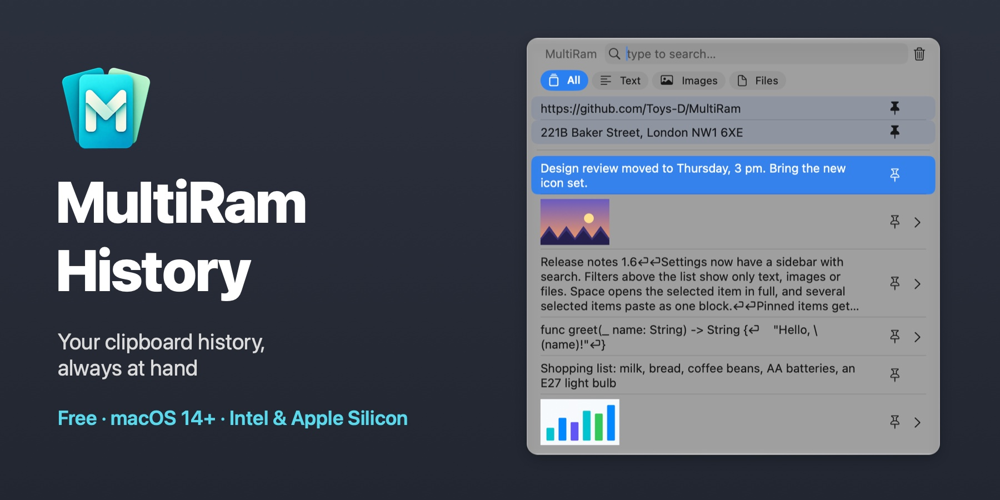

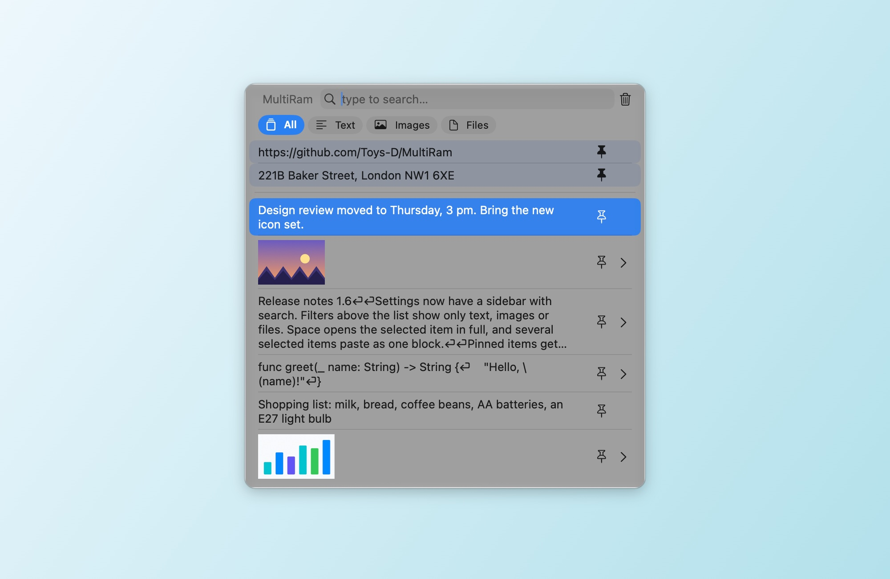

| | |
|:---:|:---:|
| 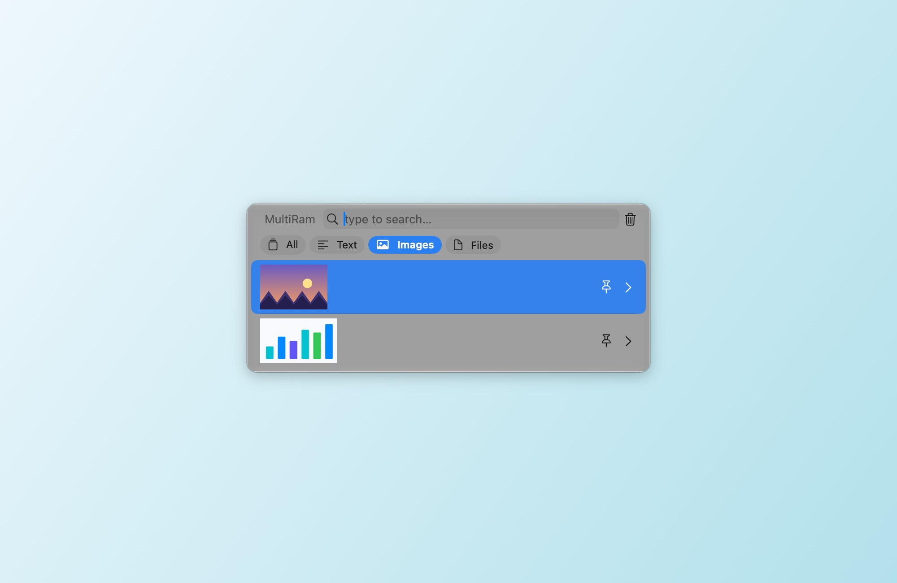 | 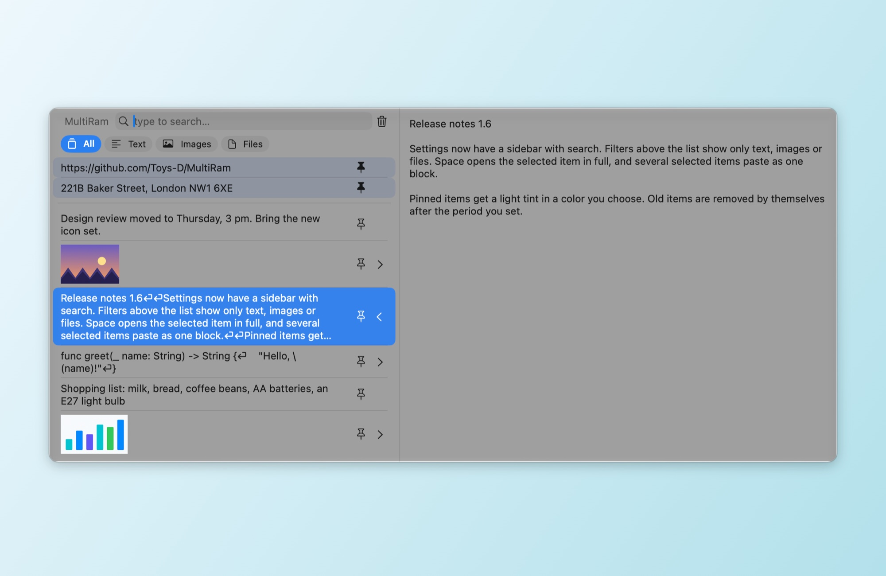 |
| **Filters:** only text, only images or only files | **Preview:** Space or ⌘Y shows the whole item |
| 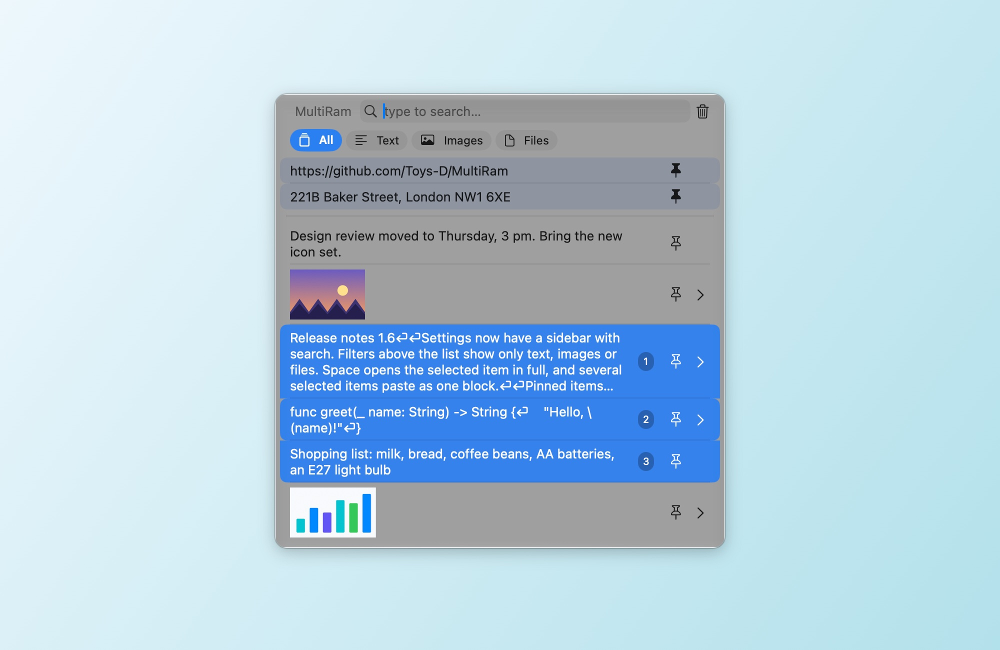 |  |
| **Paste several as one:** Shift+↓ or ⌘-click, then Return | **Settings:** a sidebar with search, live changes |

## Always at hand

Press **Option + V** and the history opens right at the cursor. Type to search, press **Return** to paste the item into the app you were working in, press **Space** to see it in full. In a password field, where macOS blocks Option-only shortcuts, **Control + Option + V** opens it all the same.

## What it does

- **Remembers everything you copy:** text, code, links, images and files, up to the number of items you choose.
- **Pastes for you.** Pick an item and it lands in the app you were working in; formatting can be stripped on the way.
- **Search** through the whole text of every item, ignoring letter case; «ё» and «е» count as one letter.
- **Filters** above the list: All, Text, Images, Files.
- **Preview.** Space or ⌘Y opens the item in a side panel: the full text, or the image at its natural size.
- **Open images in other apps.** Under a picture in the side panel are buttons for the editors found on your Mac: Preview, Photoshop, Illustrator and others.
- **Pins.** Pin what you paste often; pinned rows stay on top with a light tint in a color of your choice.
- **Paste several items as one.** Select them with Shift+↑/↓ or ⌘-click (numbers show the order) and press Return: their text is pasted as one block, one item per line.
- **Tidies itself up.** Items older than a day, a week, a month, three months or a year can be removed automatically; pinned ones stay.
- **Exclusions.** Ignore chosen apps, data types or text that matches a pattern; pause recording with one click.
- **Updates.** Once a day MultiRam asks GitHub for the latest release and offers its download page. Your history never leaves your Mac.
- **In your language:** English, Spanish, French, German, Portuguese, Chinese (Simplified and Traditional), Russian and Ukrainian. MultiRam follows the system language, or the one you pick in Settings ▸ General; if it doesn't have yours, it uses English.

## Install

1. Download [MultiRam.dmg](https://github.com/Toys-D/MultiRam/releases/latest/download/MultiRam.dmg), open it and drag **MultiRam** into Applications.
2. Open MultiRam. The first time, macOS asks for your permission; see below. The icon appears in the menu bar.
3. To let MultiRam paste for you, turn it on in **System Settings ▸ Privacy & Security ▸ Device Control and Data Access** (on macOS 14–26: **Accessibility**). MultiRam restarts by itself as soon as access is on.

### Why macOS asks for permission on the first launch

My apps are not in the Mac App Store, and I don't pay Apple's yearly developer fee ($99), so Apple does not notarize them. macOS blocks every such app the first time it is opened; this says nothing bad about the app itself. Allow it once, and from then on it opens like any other app.

**macOS 15 and later:**

1. Double-click **MultiRam** in Applications. macOS says it cannot verify the app: press **Done**, not "Move to Trash".
2. Open **System Settings ▸ Privacy & Security**.
3. Scroll down to **Security**. Next to the message that MultiRam was blocked, press **Open Anyway** (the button stays there for about an hour after the attempt).
4. Confirm with your password or Touch ID and press **Open Anyway** once more.

macOS remembers the choice. Updates are signed the same way, so they keep both this choice and the paste permission.

**Or in Terminal**, on any version: `xattr -dr com.apple.quarantine "/Applications/MultiRam.app"` removes the "downloaded from the internet" mark, and MultiRam opens without the warning.

## How to use

- **Open:** Option + V, or Control + Option + V in password fields, or the MultiRam icon in the menu bar ▸ Show History. Both shortcuts can be changed in Settings ▸ Shortcuts.
- **Paste:** click an item or press Return. ⌥ copies without pasting, ⇧⌘ pastes without formatting.
- **Find:** just type. The filters above the list narrow it to text, images or files.
- **Look:** Space (with an empty search) or ⌘Y, or the arrow at the right edge of a row.
- **Pin:** the pin button in a row or ⌥P. Delete an item with ⌥⌫.
- **Several at once:** Shift+↑/↓ or ⌘-click, then Return.
- **Settings:** ⌘, in the history window or the menu bar icon ▸ Settings. Sections on the left: General, Shortcuts, History Window, Menu Bar, Storage, Pins, Ignore, Privacy and About.

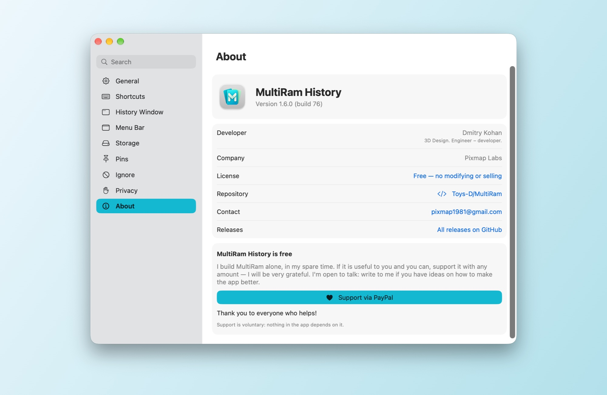

## Support the project

MultiRam History is free. I build it alone, in my spare time, because copying and pasting on a Mac deserves a proper history. If it is useful to you and you can, support it with any amount: that is what lets me spend more of my time on it. I will be very grateful.

**[Support via PayPal](https://www.paypal.com/cgi-bin/webscr?cmd=_xclick&business=pixmap1981%40gmail.com&item_name=MultiRam+History&currency_code=USD)** · pixmap1981@gmail.com · Support is voluntary; nothing in the app depends on it.

## Get in touch

Bugs, questions, ideas: **[pixmap1981@gmail.com](mailto:pixmap1981@gmail.com?subject=MultiRam%20History)**, or open an [issue](https://github.com/Toys-D/MultiRam/issues). I'm open to talk and always glad to hear how to make the app better.

## Build from source

Open `MultiRam.xcodeproj` in Xcode 16 or later and run the **MultiRam** scheme. Tests: `xcodebuild -project MultiRam.xcodeproj -scheme MultiRam -testPlan MultiRam -destination 'platform=macOS' test`. The release DMG is built with `scripts/package-release.py`; see [docs/release.md](docs/release.md).

## License

MultiRam History is free: use it at home and at work and share the original DMG. Modifying, reverse engineering and selling it are not allowed. Parts of it are based on [Maccy](https://github.com/p0deje/Maccy) by Alex Rodionov, used under the MIT License. See [LICENSE](LICENSE).

**Dmitry Kohan · Toys-D · Pixmap Labs**

---

## По-русски

**MultiRam History** — менеджер истории буфера обмена для macOS. Хранит скопированные тексты, картинки и файлы, находит любую запись за секунду и вставляет её туда, где вы работаете.

**[Скачать MultiRam.dmg](https://github.com/Toys-D/MultiRam/releases/latest/download/MultiRam.dmg)** · macOS 14 и новее · Intel и Apple Silicon · бесплатно

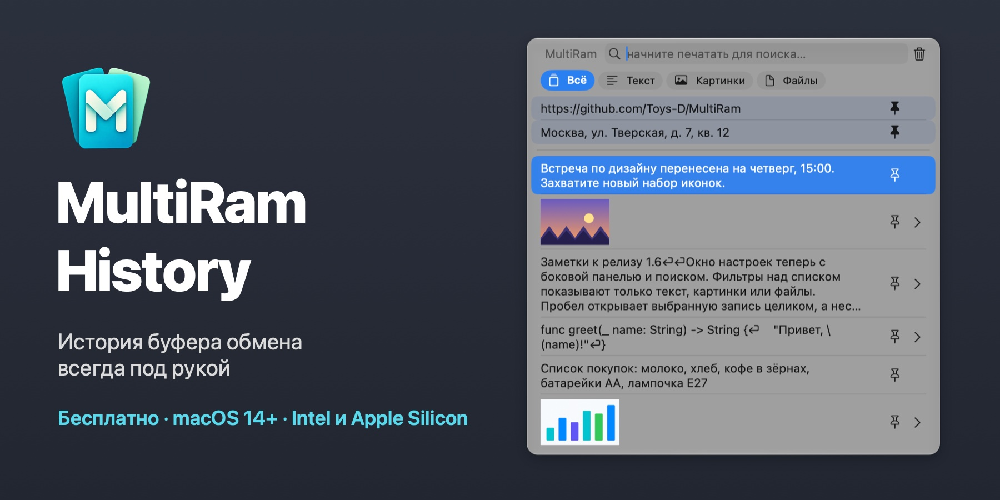

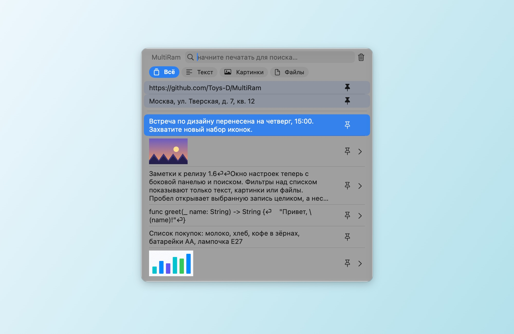

| | |
|:---:|:---:|
| 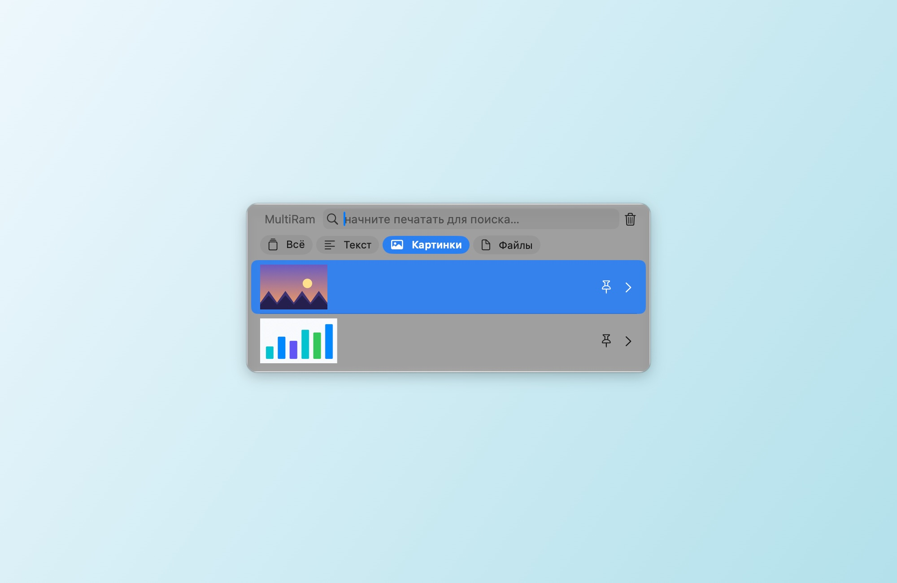 | 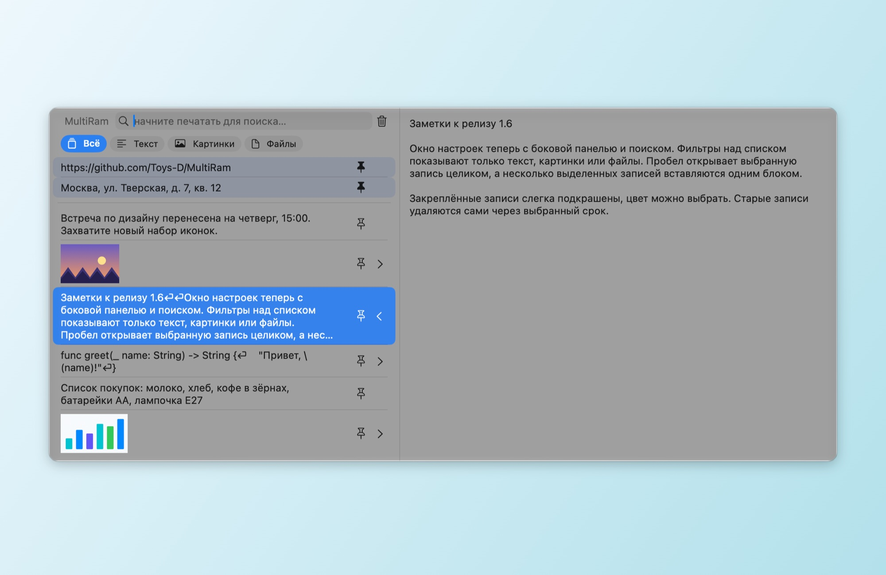 |
| **Фильтры:** только текст, только картинки или только файлы | **Предпросмотр:** пробел или ⌘Y показывает запись целиком |
| 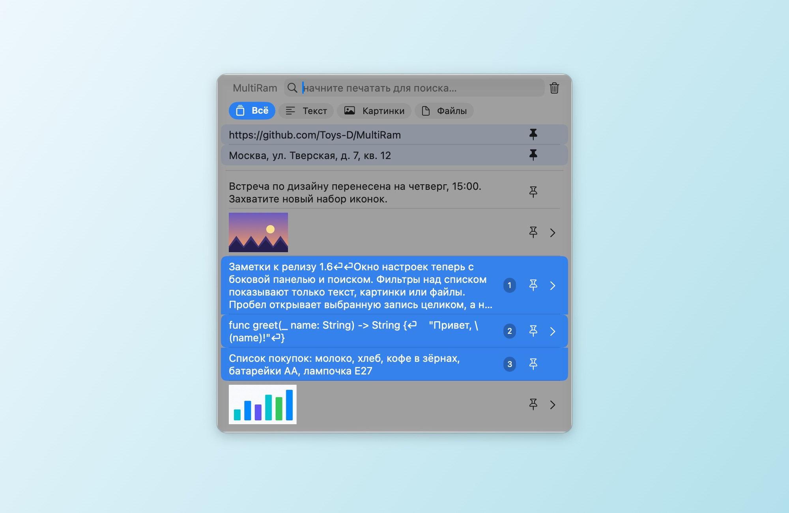 | 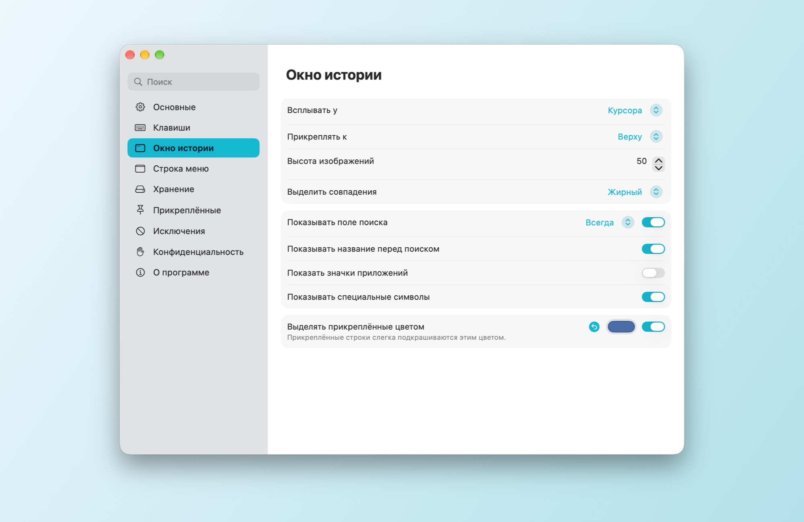 |
| **Несколько записей одним блоком:** Shift+↓ или ⌘-щелчок, затем Return | **Настройки:** боковая панель с поиском, изменения сразу |

### Всегда под рукой

Нажмите **Option + V** — история откроется прямо у курсора. Набирайте для поиска, **Return** вставит запись в программу, где вы работали, **пробел** покажет её целиком. В поле пароля, где macOS не пропускает сочетания только с Option, историю откроет **Control + Option + V**.

### Возможности

- **Запоминает всё, что вы копируете:** текст, код, ссылки, картинки и файлы — столько записей, сколько вы выберете.
- **Вставляет сама.** Выберите запись — и она окажется в программе, где вы работали; форматирование можно убрать по пути.
- **Поиск** по всему тексту каждой записи, без учёта регистра; «ё» и «е» — одна буква.
- **Фильтры** над списком: Всё, Текст, Картинки, Файлы.
- **Предпросмотр.** Пробел или ⌘Y открывает запись в боковой панели: весь текст или картинку в натуральную величину.
- **Открыть картинку в другой программе.** Под картинкой в боковой панели — кнопки редакторов, найденных на Mac: Просмотр, Photoshop, Illustrator и другие.
- **Закрепление.** Закрепите то, что вставляете часто; закреплённые строки остаются сверху и слегка подкрашены цветом на ваш выбор.
- **Несколько записей одним блоком.** Выделите их Shift+↑/↓ или ⌘-щелчком (номера показывают порядок) и нажмите Return: текст вставится одним блоком, каждая запись с новой строки.
- **Порядок сам собой.** Записи старше дня, недели, месяца, трёх месяцев или года могут удаляться автоматически; закреплённые остаются.
- **Исключения.** Не записывать выбранные программы, типы данных или текст по шаблону; приостановить запись одним щелчком.
- **Обновления.** Раз в сутки MultiRam спрашивает у GitHub номер последнего релиза и предлагает страницу загрузки. История никогда не покидает Mac.
- **На вашем языке:** английский, испанский, французский, немецкий, португальский, китайский (упрощённый и традиционный), русский и украинский. MultiRam выбирает язык по системе или тот, что вы укажете в «Настройки ▸ Основные»; если вашего языка нет, программа будет на английском.

### Установка

1. Скачайте [MultiRam.dmg](https://github.com/Toys-D/MultiRam/releases/latest/download/MultiRam.dmg), откройте его и перетащите **MultiRam** в «Программы».
2. Откройте MultiRam. В первый раз macOS спросит разрешение — как его дать, написано ниже. Значок появится в строке меню.
3. Чтобы MultiRam вставлял сам, включите его в **Системные настройки ▸ Конфиденциальность и безопасность ▸ Управление устройством и доступ к данным** (в macOS 14–26 — **Универсальный доступ**). Как только доступ включится, MultiRam перезапустится сам.

#### Почему macOS спрашивает разрешение при первом запуске

Моих программ нет в Mac App Store, и я не плачу Apple ежегодный взнос разработчика ($99), поэтому Apple их не заверяет. Любую такую программу macOS при первом запуске блокирует — о самой программе это ничего плохого не говорит. Разрешите её один раз, и дальше она открывается как любая другая.

**macOS 15 и новее:**

1. Дважды щёлкните **MultiRam** в «Программах». macOS скажет, что не может проверить программу, — нажмите **«Готово»**, а не «Переместить в Корзину».
2. Откройте **Системные настройки ▸ Конфиденциальность и безопасность**.
3. Пролистайте вниз до раздела **«Безопасность»**. Рядом с сообщением, что программа «MultiRam» заблокирована, нажмите **«Всё равно открыть»** (кнопка держится там около часа после попытки).
4. Подтвердите паролем или Touch ID и ещё раз нажмите **«Всё равно открыть»**.

macOS запомнит выбор. Обновления подписаны так же, поэтому сохраняют и этот выбор, и разрешение на вставку.

**Или в Терминале**, на любой версии: `xattr -dr com.apple.quarantine "/Applications/MultiRam.app"` — команда убирает пометку «загружено из интернета», и MultiRam открывается без предупреждения.

### Как пользоваться

- **Открыть:** Option + V, в полях паролей — Control + Option + V, или значок MultiRam в строке меню ▸ «Показать историю». Оба сочетания меняются в «Настройки ▸ Клавиши».
- **Вставить:** щёлкните запись или нажмите Return. С ⌥ — только скопировать, с ⇧⌘ — вставить без форматирования.
- **Найти:** просто набирайте. Фильтры над списком оставят только текст, картинки или файлы.
- **Посмотреть:** пробел (когда поле поиска пустое) или ⌘Y, или стрелка у правого края строки.
- **Закрепить:** кнопка-булавка в строке или ⌥P. Удалить запись — ⌥⌫.
- **Несколько сразу:** Shift+↑/↓ или ⌘-щелчок, затем Return.
- **Настройки:** ⌘, в окне истории или значок в строке меню ▸ «Настройки». Разделы слева: «Основные», «Клавиши», «Окно истории», «Строка меню», «Хранение», «Прикреплённые», «Исключения», «Конфиденциальность» и «О программе».

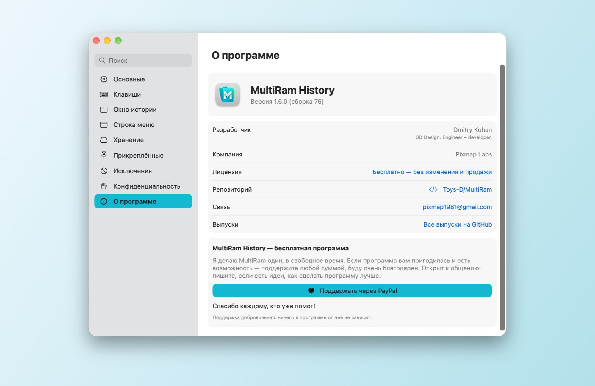

### Поддержать проект

MultiRam History — бесплатная программа. Я делаю её один, в свободное время, потому что копирование и вставка на Mac заслуживают нормальной истории. Если программа вам пригодилась и есть возможность — поддержите любой суммой: так я смогу уделять ей больше времени. Буду очень благодарен.

**[Поддержать через PayPal](https://www.paypal.com/cgi-bin/webscr?cmd=_xclick&business=pixmap1981%40gmail.com&item_name=MultiRam+History&currency_code=USD)** · pixmap1981@gmail.com · Поддержка добровольная, ничего в программе от неё не зависит.

### Связь

Ошибки, вопросы, идеи — пишите: **[pixmap1981@gmail.com](mailto:pixmap1981@gmail.com?subject=MultiRam%20History)** или откройте [issue на GitHub](https://github.com/Toys-D/MultiRam/issues). Открыт к общению и всегда рад подсказкам, как сделать программу лучше.

### Сборка из исходников

Откройте `MultiRam.xcodeproj` в Xcode 16 или новее и запустите схему **MultiRam**. Тесты: `xcodebuild -project MultiRam.xcodeproj -scheme MultiRam -testPlan MultiRam -destination 'platform=macOS' test`. Релизный DMG собирает `scripts/package-release.py`, порядок — в [docs/release.md](docs/release.md).

### Лицензия

MultiRam History бесплатна: ею можно пользоваться дома и на работе и передавать оригинальный DMG. Изменять, разбирать и продавать её нельзя. Часть кода основана на [Maccy](https://github.com/p0deje/Maccy) Алексея Родионова и используется по лицензии MIT. Подробно — в [LICENSE](LICENSE).

**Dmitry Kohan · Toys-D · Pixmap Labs**
