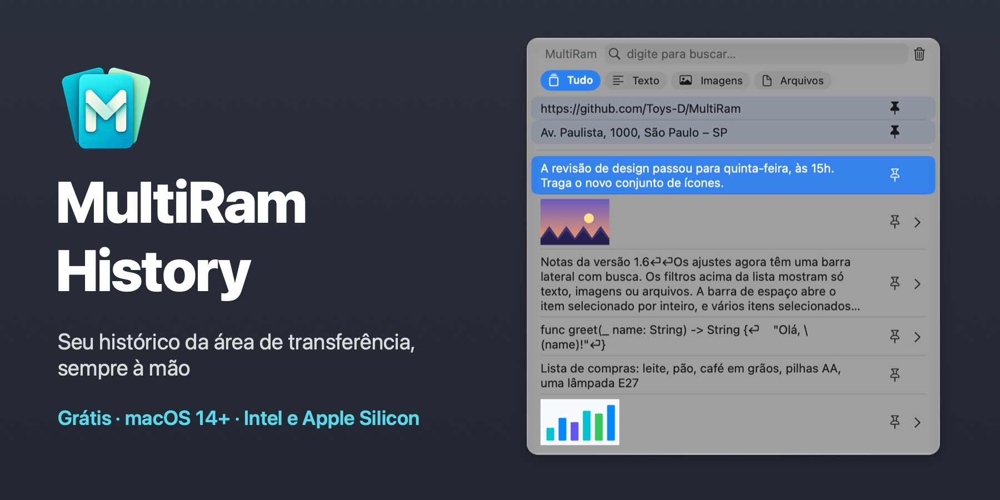
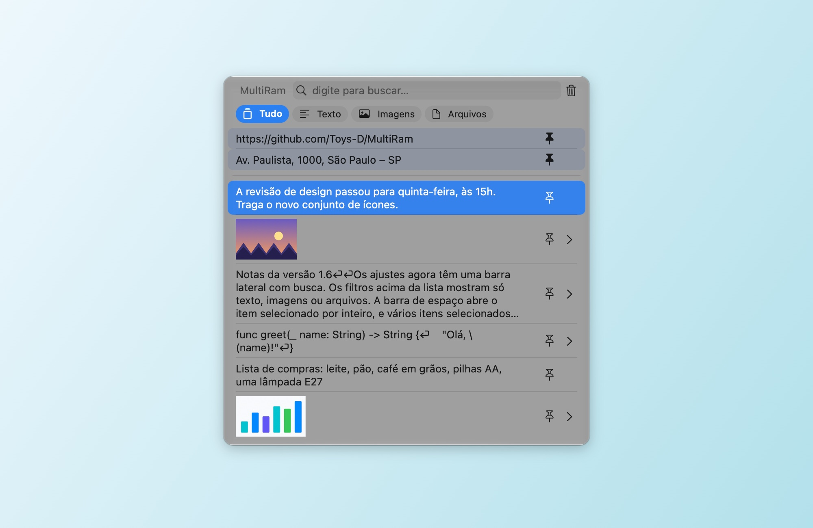
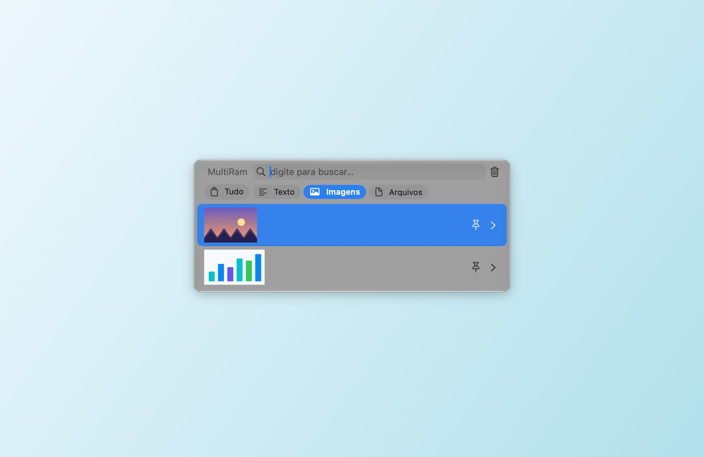
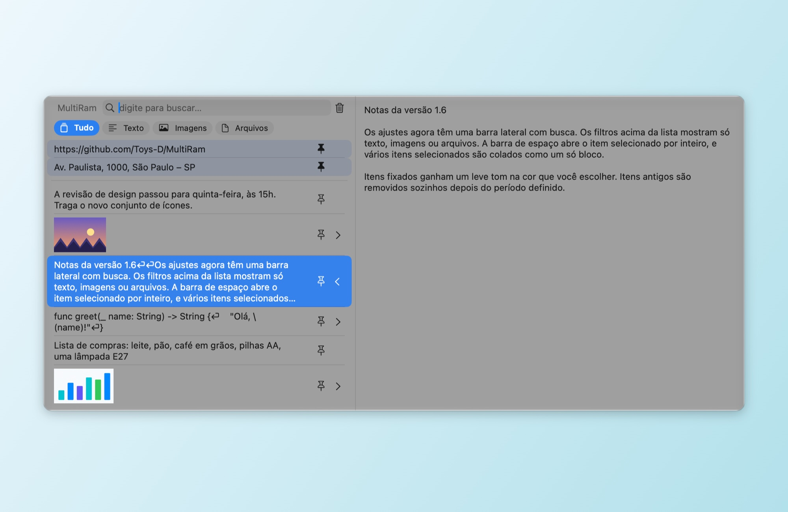
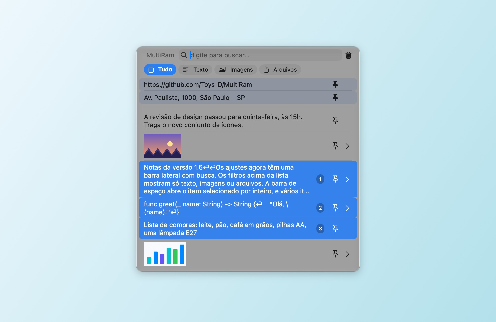
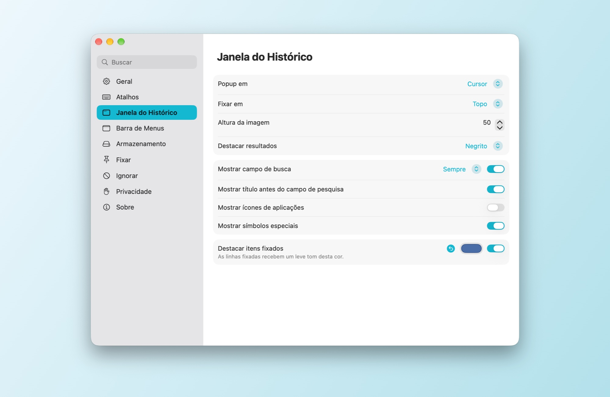
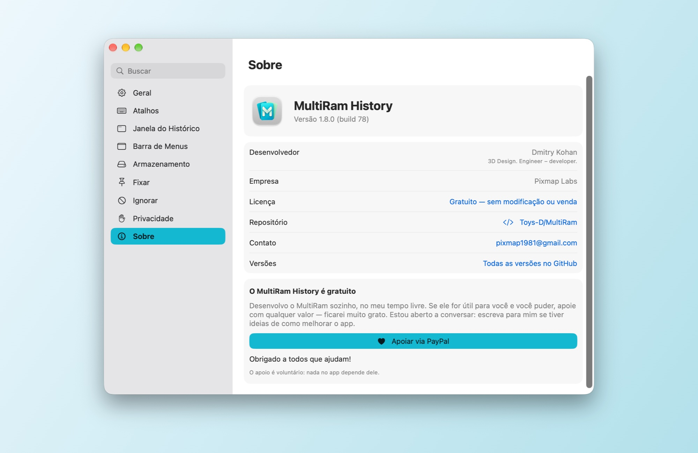

# MultiRam History

[English](README.md) · [Русский](README.md#по-русски) · [Español](README.es.md) · [Français](README.fr.md) · [Deutsch](README.de.md) · **Português** · [简体中文](README.zh-Hans.md) · [繁體中文](README.zh-Hant.md) · [Українська](README.uk.md)

Um gerenciador de histórico da área de transferência para macOS. O MultiRam guarda os textos, as imagens e os arquivos que você copia, encontra qualquer um deles em um segundo e cola de volta onde você está trabalhando.

**[Baixar MultiRam.dmg](https://github.com/Toys-D/MultiRam/releases/latest/download/MultiRam.dmg)** · macOS 14 ou posterior · Intel e Apple Silicon · 9 idiomas · gratuito

| | |
|:---:|:---:|
|  |  |
| **Filtros:** só texto, só imagens ou só arquivos | **Pré-visualização:** Espaço ou ⌘Y mostra o item inteiro |
|  |  |
| **Colar vários como um só:** Shift+↓ ou ⌘-clique e depois Return | **Ajustes:** barra lateral com busca, mudanças na hora |

## Sempre à mão

Pressione **Option + V** e o histórico abre bem ao lado do cursor. Digite para buscar, pressione **Return** para colar o item no app em que você estava trabalhando ou pressione **Espaço** para vê-lo por inteiro. Em um campo de senha, onde o macOS bloqueia os atalhos só com Option, **Control + Option + V** abre o histórico do mesmo jeito.

## O que ele faz

- **Lembra de tudo o que você copia:** texto, código, links, imagens e arquivos, até o número de itens que você escolher.
- **Cola por você.** Escolha um item e ele vai parar no app em que você estava trabalhando; a formatação pode ser removida no caminho.
- **Busca** no texto inteiro de cada item, sem diferenciar maiúsculas e minúsculas; em russo, «ё» e «е» contam como a mesma letra.
- **Filtros** acima da lista: Tudo, Texto, Imagens, Arquivos.
- **Pré-visualização.** Espaço ou ⌘Y abre o item em um painel lateral: o texto inteiro ou a imagem no tamanho original.
- **Abra imagens em outros apps.** Abaixo da imagem, no painel lateral, há botões para os editores encontrados no seu Mac: Pré-Visualização, Photoshop, Illustrator e outros.
- **Itens fixados.** Fixe o que você cola com frequência; as linhas fixadas ficam no topo, com um leve tom da cor que você escolher.
- **Cole vários itens como um só.** Selecione-os com Shift+↑/↓ ou ⌘-clique (os números mostram a ordem) e pressione Return: o texto deles é colado em um único bloco, um item por linha.
- **Faz a própria limpeza.** Itens com mais de um dia, uma semana, um mês, três meses ou um ano podem ser removidos automaticamente; os fixados ficam.
- **Exceções.** Ignore apps, tipos de dados ou textos que correspondam a um padrão; pause a gravação com um clique.
- **Atualizações.** Uma vez por dia, o MultiRam consulta o GitHub para saber qual é a versão mais recente e oferece a página de download. Seu histórico nunca sai do seu Mac.
- **No seu idioma:** inglês, espanhol, francês, alemão, português, chinês (simplificado e tradicional), russo e ucraniano. O MultiRam segue o idioma do sistema ou o que você escolher em Ajustes ▸ Geral; se o seu idioma não estiver entre eles, ele usa o inglês.

## Idiomas disponíveis

O MultiRam está totalmente traduzido para nove idiomas:

| Idioma | Em português |
|---|---|
| English | Inglês |
| Español | Espanhol |
| Français | Francês |
| Deutsch | Alemão |
| Português (Brasil) | Português (Brasil) |
| 简体中文 | Chinês (simplificado) |
| 繁體中文 | Chinês (tradicional) |
| Русский | Russo |
| Українська | Ucraniano |

Ele segue o idioma do macOS ou o que você escolher em **Ajustes ▸ Geral ▸ Idioma**. Se o seu Mac usa um idioma que não está nesta lista, o MultiRam fica em inglês.

## Instalação

1. Baixe o [MultiRam.dmg](https://github.com/Toys-D/MultiRam/releases/latest/download/MultiRam.dmg), abra-o e arraste o **MultiRam** para Aplicativos.
2. Abra o MultiRam. Na primeira vez, o macOS pede a sua permissão (veja abaixo). O ícone aparece na barra de menus.
3. Para que o MultiRam possa colar por você, ative-o em **Ajustes do Sistema ▸ Privacidade e Segurança ▸ Controle do Dispositivo e Acesso a Dados** (no macOS 14–26: **Acessibilidade**). O MultiRam reinicia sozinho assim que o acesso é ativado.

### Por que o macOS pede permissão na primeira abertura

Meus apps não estão na Mac App Store e eu não pago a taxa anual de desenvolvedor da Apple (US$ 99), por isso a Apple não os notariza. O macOS bloqueia qualquer app assim na primeira vez que ele é aberto; isso não diz nada de ruim sobre o app em si. Permita uma vez e, a partir daí, ele abre como qualquer outro app.

**macOS 15 e posterior:**

1. Clique duas vezes no **MultiRam** em Aplicativos. O macOS avisa que não consegue verificar o app: clique em **OK**, não em “Mover para o Lixo”.
2. Abra **Ajustes do Sistema ▸ Privacidade e Segurança**.
3. Role até **Segurança**. Ao lado da mensagem de que o MultiRam foi bloqueado, clique em **Abrir Mesmo Assim** (o botão fica lá por cerca de uma hora depois da tentativa).
4. Confirme com a sua senha ou com o Touch ID e clique em **Abrir Mesmo Assim** mais uma vez.

O macOS lembra da escolha. As atualizações são assinadas da mesma forma, então mantêm tanto essa escolha quanto a permissão para colar.

**Ou no Terminal**, em qualquer versão: `xattr -dr com.apple.quarantine "/Applications/MultiRam.app"` remove a marca de “baixado da internet”, e o MultiRam abre sem o aviso.

## Como usar

- **Abrir:** Option + V, ou Control + Option + V em campos de senha, ou o ícone do MultiRam na barra de menus ▸ Mostrar Histórico. Os dois atalhos podem ser alterados em Ajustes ▸ Atalhos.
- **Colar:** clique em um item ou pressione Return. ⌥ copia sem colar; ⇧⌘ cola sem formatação.
- **Encontrar:** é só digitar. Os filtros acima da lista a restringem a texto, imagens ou arquivos.
- **Ver:** Espaço (com a busca vazia) ou ⌘Y, ou a seta na borda direita de uma linha.
- **Fixar:** o botão de fixar na linha ou ⌥P. Para apagar um item, ⌥⌫.
- **Vários de uma vez:** Shift+↑/↓ ou ⌘-clique e depois Return.
- **Ajustes:** ⌘, na janela do histórico ou o ícone na barra de menus ▸ Ajustes. Seções à esquerda: Geral, Atalhos, Janela do Histórico, Barra de Menus, Armazenamento, Fixar, Ignorar, Privacidade e Sobre.

## Apoie o projeto

O MultiRam History é gratuito. Eu o faço sozinho, no meu tempo livre, porque copiar e colar no Mac merece um histórico de verdade. Se ele for útil para você e você puder, apoie com qualquer valor: é isso que me permite dedicar mais do meu tempo a ele. Vou ficar muito grato.

**[Apoiar via PayPal](https://www.paypal.com/cgi-bin/webscr?cmd=_xclick&business=pixmap1981%40gmail.com&item_name=MultiRam+History&currency_code=USD)** · pixmap1981@gmail.com · O apoio é voluntário; nada no app depende dele.

## Fale comigo

Bugs, dúvidas, ideias: **[pixmap1981@gmail.com](mailto:pixmap1981@gmail.com?subject=MultiRam%20History)**, ou abra uma [issue](https://github.com/Toys-D/MultiRam/issues). Estou aberto a conversar e sempre fico feliz em saber como deixar o app melhor.

## Compilar a partir do código-fonte

Abra `MultiRam.xcodeproj` no Xcode 16 ou posterior e execute o esquema **MultiRam**. Testes: `xcodebuild -project MultiRam.xcodeproj -scheme MultiRam -testPlan MultiRam -destination 'platform=macOS' test`. O DMG da versão é gerado com `scripts/package-release.py`; veja [docs/release.md](docs/release.md).

## Licença

O MultiRam History é gratuito: use em casa e no trabalho e compartilhe o DMG original. Não é permitido modificá-lo, fazer engenharia reversa nem vendê-lo. Partes dele são baseadas no [Maccy](https://github.com/p0deje/Maccy), de Alex Rodionov, usado sob a Licença MIT. Veja [LICENSE](LICENSE).

**Dmitry Kohan · Toys-D · Pixmap Labs**
