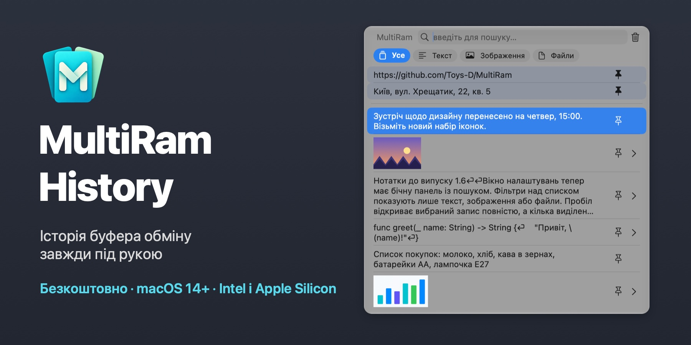
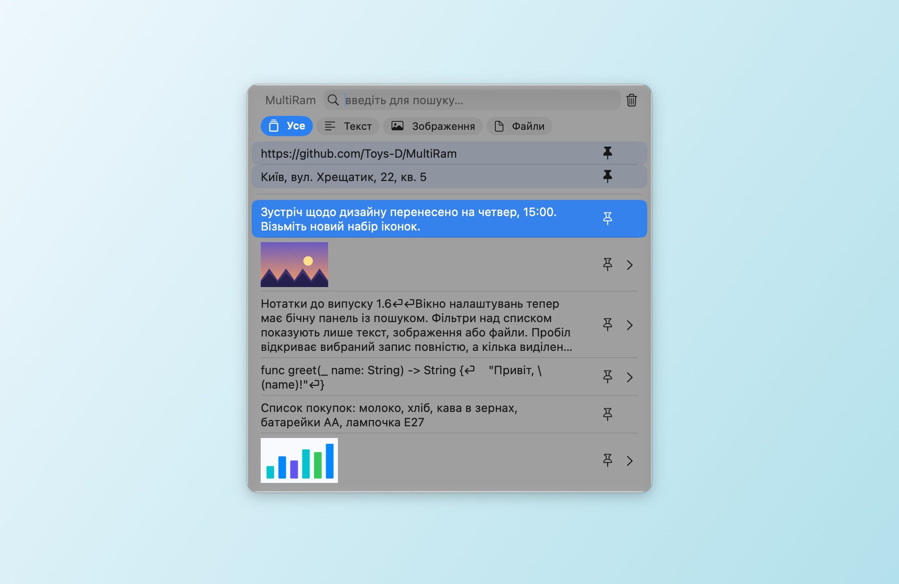
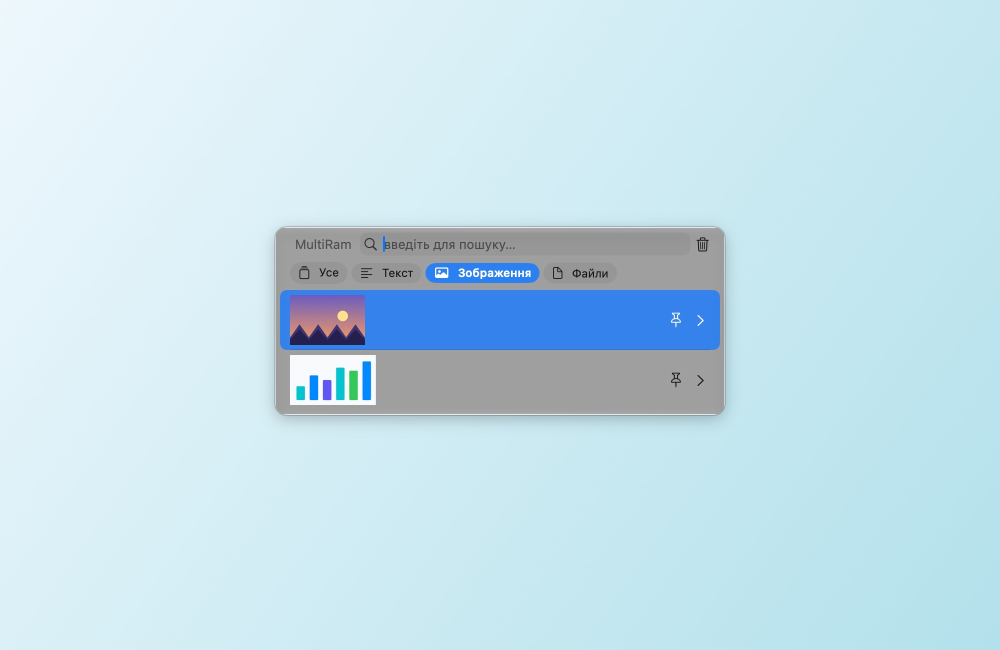
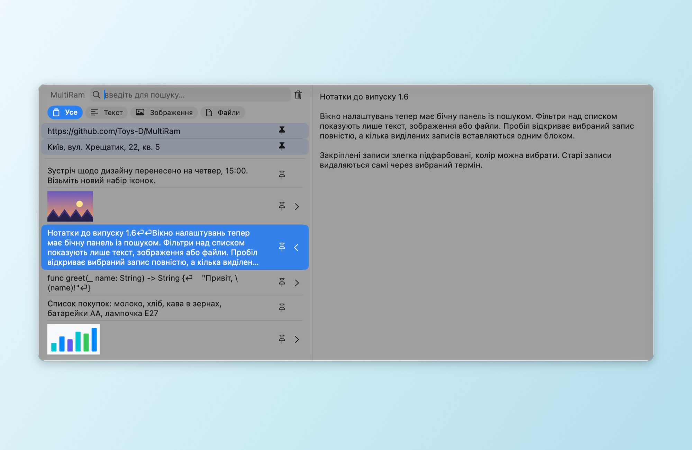
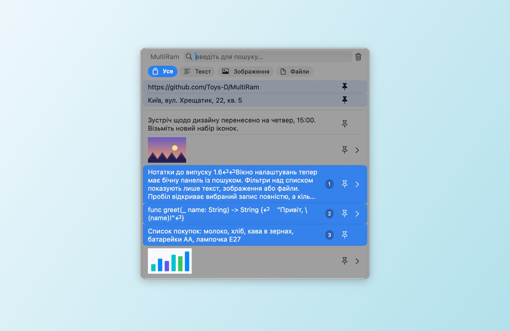
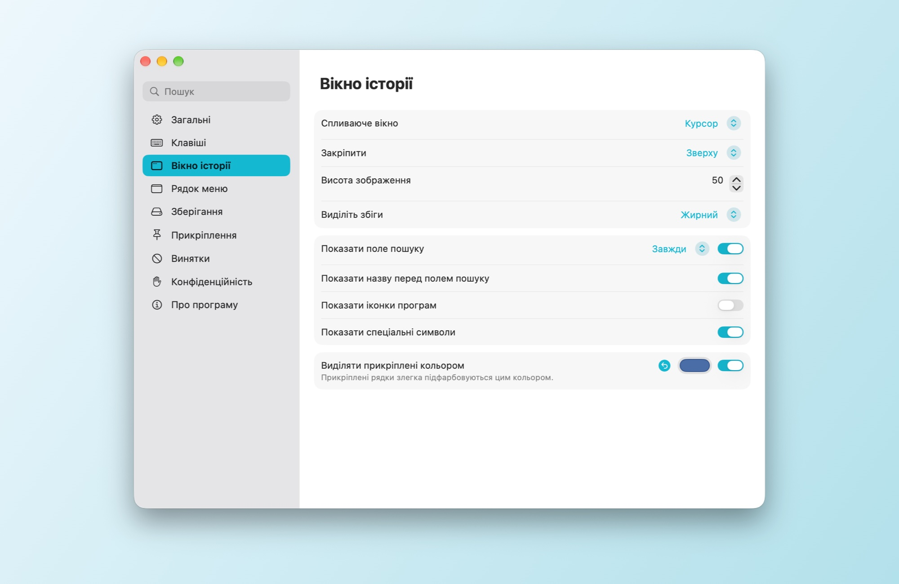
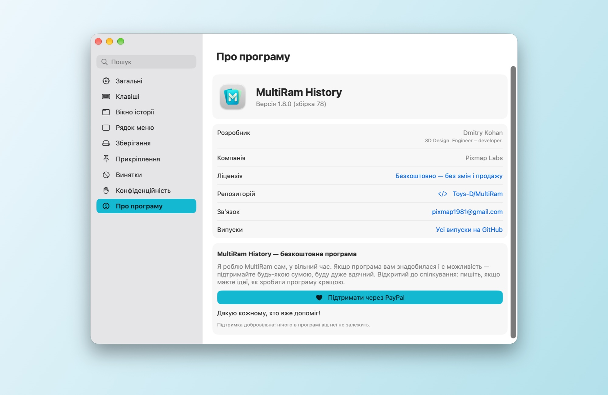

# MultiRam History

[English](README.md) · [Русский](README.md#по-русски) · [Español](README.es.md) · [Français](README.fr.md) · [Deutsch](README.de.md) · [Português](README.pt-BR.md) · [简体中文](README.zh-Hans.md) · [繁體中文](README.zh-Hant.md) · **Українська**

Менеджер історії буфера обміну для macOS. MultiRam зберігає скопійовані тексти, зображення й файли, за секунду знаходить будь-який запис і вставляє його туди, де ви працюєте.

**[Завантажити MultiRam.dmg](https://github.com/Toys-D/MultiRam/releases/latest/download/MultiRam.dmg)** · macOS 14 і новіші · Intel і Apple Silicon · 9 мов · безкоштовно

| | |
|:---:|:---:|
|  |  |
| **Фільтри:** лише текст, лише зображення або лише файли | **Перегляд:** пробіл або ⌘Y показує запис повністю |
|  |  |
| **Кілька записів одним блоком:** Shift+↓ або ⌘-клацання, потім Return | **Налаштування:** бічна панель із пошуком, зміни діють одразу |

## Завжди під рукою

Натисніть **Option + V**, і історія відкриється просто біля курсора. Друкуйте, щоб шукати; **Return** вставить запис у програму, де ви працювали, **пробіл** покаже його повністю. У полі пароля, де macOS блокує сполучення лише з Option, історію відкриє **Control + Option + V**.

## Можливості

- **Запам’ятовує все, що ви копіюєте:** текст, код, посилання, зображення й файли — стільки записів, скільки ви оберете.
- **Вставляє сам.** Виберіть запис, і він опиниться в програмі, де ви працювали; форматування можна прибрати дорогою.
- **Пошук** по всьому тексту кожного запису без урахування регістру; у російській «ё» і «е» вважаються однією літерою.
- **Фільтри** над списком: Усе, Текст, Зображення, Файли.
- **Перегляд.** Пробіл або ⌘Y відкриває запис у бічній панелі: увесь текст або зображення в натуральну величину.
- **Відкрити зображення в іншій програмі.** Під зображенням у бічній панелі є кнопки редакторів, знайдених на вашому Mac: Перегляд, Photoshop, Illustrator та інші.
- **Прикріплення.** Прикріпіть те, що вставляєте часто; прикріплені рядки лишаються вгорі й злегка підфарбовані кольором на ваш вибір.
- **Кілька записів одним блоком.** Виділіть їх Shift+↑/↓ або ⌘-клацанням (номери показують порядок) і натисніть Return: текст вставиться одним блоком, кожен запис з нового рядка.
- **Сам наводить лад.** Записи, старші за день, тиждень, місяць, три місяці або рік, можуть видалятися автоматично; прикріплені лишаються.
- **Винятки.** Не записувати вибрані програми, типи даних або текст за шаблоном; призупинити запис одним клацанням.
- **Оновлення.** Раз на добу MultiRam питає в GitHub номер останнього релізу й пропонує сторінку завантаження. Історія ніколи не залишає ваш Mac.
- **Вашою мовою:** англійська, іспанська, французька, німецька, португальська, китайська (спрощена й традиційна), російська та українська. MultiRam бере мову системи або ту, що ви оберете в «Налаштування ▸ Загальні»; якщо вашої мови немає, програма буде англійською.

## Підтримувані мови

MultiRam повністю перекладено дев’ятьма мовами:

| Мова | Українською |
|---|---|
| English | англійська |
| Español | іспанська |
| Français | французька |
| Deutsch | німецька |
| Português (Brasil) | португальська (Бразилія) |
| 简体中文 | китайська (спрощена) |
| 繁體中文 | китайська (традиційна) |
| Русский | російська |
| Українська | українська |

Програма бере мову macOS або ту, що ви оберете в **«Налаштування ▸ Загальні ▸ Мова»**. Якщо мови вашого Mac немає в цьому списку, MultiRam буде англійською.

## Встановлення

1. Завантажте [MultiRam.dmg](https://github.com/Toys-D/MultiRam/releases/latest/download/MultiRam.dmg), відкрийте його й перетягніть **MultiRam** у «Програми».
2. Відкрийте MultiRam. Першого разу macOS попросить дозволу — як його надати, написано нижче. Значок з’явиться в рядку меню.
3. Щоб MultiRam вставляв сам, увімкніть його в **Системні параметри ▸ Приватність і безпека ▸ Керування пристроями й доступ до даних** (у macOS 14–26 — **Доступність**). Щойно доступ увімкнеться, MultiRam перезапуститься сам.

### Чому macOS просить дозволу під час першого запуску

Моїх програм немає в Mac App Store, і я не плачу Apple щорічний внесок розробника ($99), тому Apple їх не нотаризує. macOS блокує кожну таку програму під час першого відкриття — про саму програму це нічого поганого не каже. Дозвольте її один раз, і далі вона відкриватиметься, як будь-яка інша.

**macOS 15 і новіші:**

1. Двічі клацніть **MultiRam** у «Програмах». macOS повідомить, що не може перевірити програму, — натисніть **«Готово»**, а не «Перемістити в Смітник».
2. Відкрийте **Системні параметри ▸ Приватність і безпека**.
3. Прокрутіть униз до розділу **«Безпека»**. Поруч із повідомленням, що програму «MultiRam» заблоковано, натисніть **«Все одно відкрити»** (кнопка лишається там приблизно годину після спроби).
4. Підтвердьте паролем або Touch ID і ще раз натисніть **«Все одно відкрити»**.

macOS запам’ятає вибір. Оновлення підписано так само, тож вони зберігають і цей вибір, і дозвіл на вставлення.

**Або в Терміналі**, у будь-якій версії: `xattr -dr com.apple.quarantine "/Applications/MultiRam.app"` — команда прибирає позначку «завантажено з інтернету», і MultiRam відкривається без попередження.

## Як користуватися

- **Відкрити:** Option + V, у полях паролів — Control + Option + V, або значок MultiRam у рядку меню ▸ «Показати історію». Обидва сполучення можна змінити в «Налаштування ▸ Клавіші».
- **Вставити:** клацніть запис або натисніть Return. З ⌥ — лише скопіювати, з ⇧⌘ — вставити без форматування.
- **Знайти:** просто друкуйте. Фільтри над списком залишать лише текст, зображення або файли.
- **Переглянути:** пробіл (коли поле пошуку порожнє) або ⌘Y, або стрілка біля правого краю рядка.
- **Прикріпити:** кнопка-шпилька в рядку або ⌥P. Видалити запис — ⌥⌫.
- **Кілька одразу:** Shift+↑/↓ або ⌘-клацання, потім Return.
- **Налаштування:** ⌘, у вікні історії або значок у рядку меню ▸ «Налаштування». Розділи ліворуч: «Загальні», «Клавіші», «Вікно історії», «Рядок меню», «Зберігання», «Прикріплення», «Винятки», «Конфіденційність» і «Про програму».

## Підтримати проєкт

MultiRam History — безкоштовна програма. Я роблю її сам, у вільний час, бо копіювання й вставлення на Mac заслуговують на нормальну історію. Якщо програма вам знадобилася і є можливість — підтримайте будь-якою сумою: так я зможу приділяти їй більше часу. Буду дуже вдячний.

**[Підтримати через PayPal](https://www.paypal.com/cgi-bin/webscr?cmd=_xclick&business=pixmap1981%40gmail.com&item_name=MultiRam+History&currency_code=USD)** · pixmap1981@gmail.com · Підтримка добровільна, у програмі від неї нічого не залежить.

## Зв’язок

Помилки, запитання, ідеї — пишіть: **[pixmap1981@gmail.com](mailto:pixmap1981@gmail.com?subject=MultiRam%20History)** або відкрийте [issue на GitHub](https://github.com/Toys-D/MultiRam/issues). Відкритий до спілкування й завжди радий підказкам, як зробити програму кращою.

## Збирання з вихідного коду

Відкрийте `MultiRam.xcodeproj` у Xcode 16 або новішому й запустіть схему **MultiRam**. Тести: `xcodebuild -project MultiRam.xcodeproj -scheme MultiRam -testPlan MultiRam -destination 'platform=macOS' test`. Релізний DMG збирає `scripts/package-release.py`, порядок описано в [docs/release.md](docs/release.md).

## Ліцензія

MultiRam History безкоштовна: нею можна користуватися вдома й на роботі та передавати оригінальний DMG. Змінювати, розбирати й продавати її не можна. Частину коду засновано на [Maccy](https://github.com/p0deje/Maccy) Олексія Родіонова, вона використовується за ліцензією MIT. Докладніше — у [LICENSE](LICENSE).

**Dmitry Kohan · Toys-D · Pixmap Labs**
