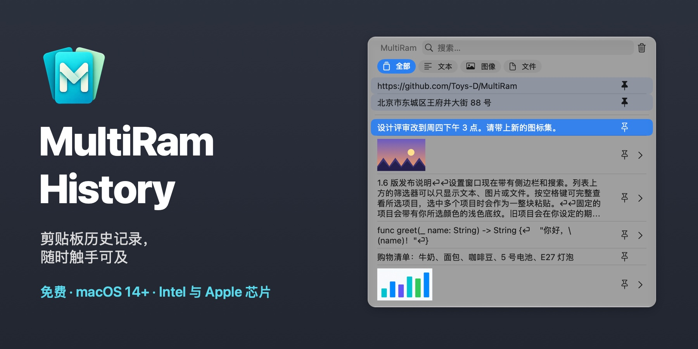
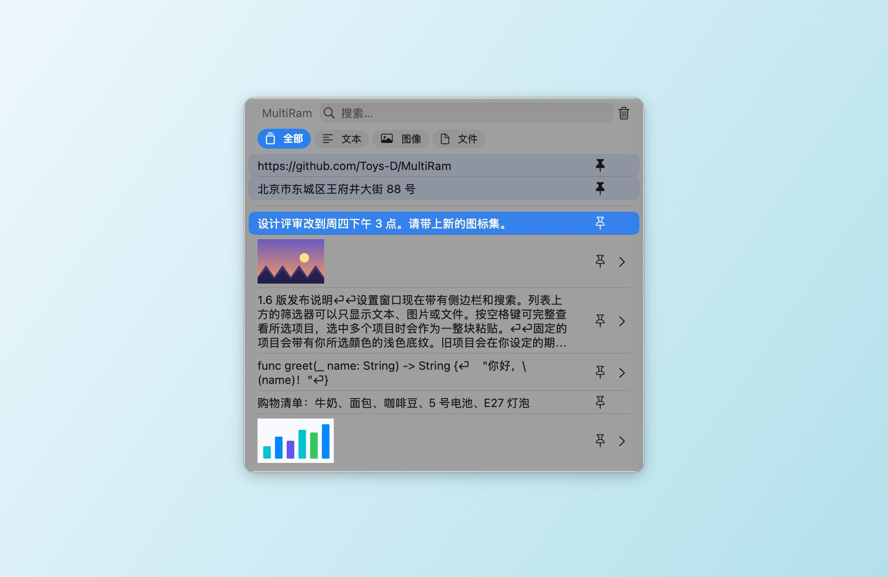
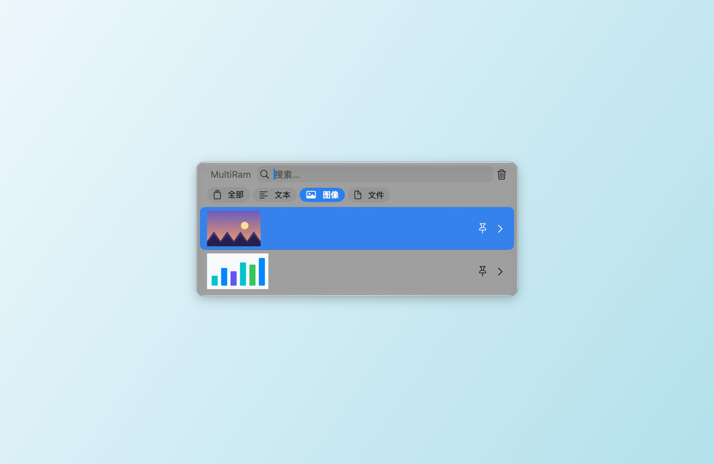
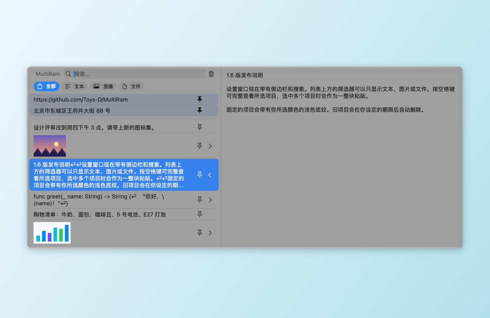
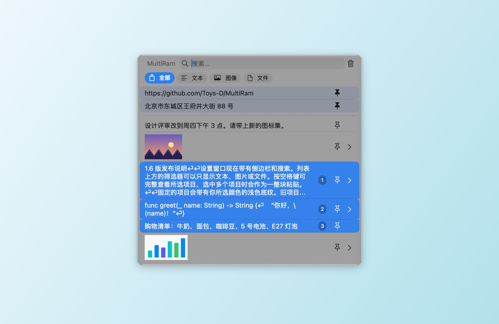
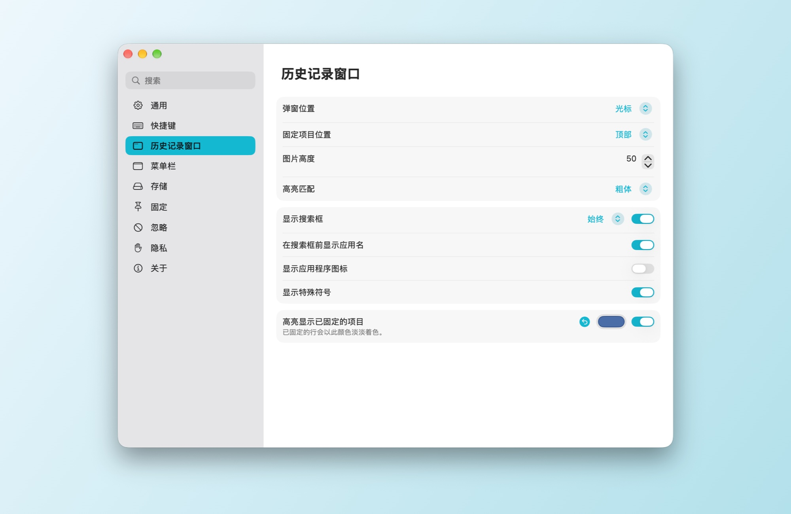
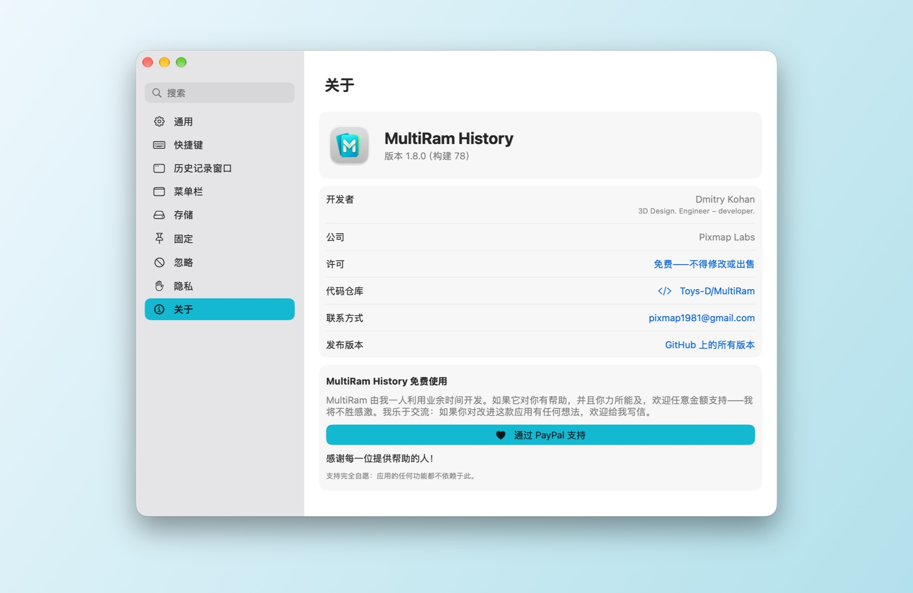

# MultiRam History

[English](README.md) · [Русский](README.md#по-русски) · [Español](README.es.md) · [Français](README.fr.md) · [Deutsch](README.de.md) · [Português](README.pt-BR.md) · **简体中文** · [繁體中文](README.zh-Hant.md) · [Українська](README.uk.md)

一款 macOS 剪贴板历史记录管理器。MultiRam 会保存你拷贝的文本、图像和文件，一秒内就能找到其中任意一项，并把它粘贴回你正在工作的地方。

**[下载 MultiRam.dmg](https://github.com/Toys-D/MultiRam/releases/latest/download/MultiRam.dmg)** · macOS 14 或更高版本 · Intel 和 Apple 芯片 · 9 种语言 · 免费

| | |
|:---:|:---:|
|  |  |
| **筛选**：只看文本、图像或文件 | **预览**：按空格键或 ⌘Y 查看完整项目 |
|  |  |
| **多项合并粘贴**：Shift+↓ 或 ⌘-点按，然后按 Return 键 | **设置**：带搜索的侧边栏，更改即时生效 |

## 随时触手可及

按下 **Option + V**，历史记录就会在光标处打开。直接输入即可搜索，按 **Return** 键把项目粘贴到你正在使用的应用中，按**空格键**查看完整内容。在密码栏中，macOS 会屏蔽仅用 Option 的快捷键，这时按 **Control + Option + V** 同样可以打开。

## 功能

- **记住你拷贝的一切**：文本、代码、链接、图像和文件，保存数量由你决定。
- **替你粘贴**。选择一个项目，它就会出现在你正在使用的应用中；还可以顺便去掉格式。
- **搜索**每个项目的全部文本，不区分大小写；在俄语中，«ё» 和 «е» 视为同一个字母。
- 列表上方的**筛选器**：全部、文本、图像、文件。
- **预览**。按空格键或 ⌘Y 会在侧边面板中打开项目：显示完整文本，或按原始尺寸显示图像。
- **在其他应用中打开图像**。侧边面板中的图片下方有按钮，对应你 Mac 上找到的编辑器：预览、Photoshop、Illustrator 等。
- **固定**。把经常粘贴的内容固定起来；固定的行始终位于顶部，并带有你所选颜色的淡淡色调。
- **多项合并粘贴**。用 Shift+↑/↓ 或 ⌘-点按选中它们（数字表示顺序），然后按 Return 键：它们的文本会作为一整块粘贴，每项一行。
- **自动整理**。超过一天、一周、一个月、三个月或一年的项目可以自动删除；已固定的项目会保留。
- **排除**。忽略指定的应用、数据类型或匹配某个模式的文本；一键暂停记录。
- **更新**。MultiRam 每天向 GitHub 查询一次最新版本，并提供它的下载页面。你的历史记录绝不会离开你的 Mac。
- **使用你的语言**：英语、西班牙语、法语、德语、葡萄牙语、中文（简体和繁体）、俄语和乌克兰语。MultiRam 跟随系统语言，也可以使用你在 设置 ▸ 通用 中选择的语言；如果没有你的语言，则使用英语。

## 支持的语言

MultiRam 已完整翻译成九种语言：

| 语言 | 中文名称 |
|---|---|
| English | 英语 |
| Español | 西班牙语 |
| Français | 法语 |
| Deutsch | 德语 |
| Português (Brasil) | 葡萄牙语（巴西） |
| 简体中文 | 中文（简体） |
| 繁體中文 | 中文（繁体） |
| Русский | 俄语 |
| Українська | 乌克兰语 |

它会跟随 macOS 的语言，也可以使用你在 **设置 ▸ 通用 ▸ 语言** 中选择的语言。如果你的 Mac 使用的语言不在此列，MultiRam 会显示为英语。

## 安装

1. 下载 [MultiRam.dmg](https://github.com/Toys-D/MultiRam/releases/latest/download/MultiRam.dmg)，打开它，然后将 **MultiRam** 拖到“应用程序”文件夹。
2. 打开 MultiRam。首次打开时，macOS 会请求你的允许，详见下文。图标会出现在菜单栏中。
3. 要让 MultiRam 替你粘贴，请在 **系统设置 ▸ 隐私与安全 ▸ 设备控制和数据访问**（macOS 14–26 上为 **无障碍**）中打开它。访问权限一经开启，MultiRam 会自动重新启动。

### 为什么首次打开时 macOS 会请求允许

我的应用没有在 Mac App Store 上架，我也不支付 Apple 每年的开发者费用（99 美元），所以 Apple 不会对它们进行公证。macOS 会在首次打开时拦截所有这类应用，这并不说明应用本身有任何问题。只需允许一次，之后它就会像其他应用一样正常打开。

**macOS 15 及更高版本：**

1. 在“应用程序”文件夹中连按 **MultiRam**。macOS 提示无法验证该应用：请点按 **完成**，而不是“移到废纸篓”。
2. 打开 **系统设置 ▸ 隐私与安全**。
3. 向下滚动到 **安全性** 部分。在 MultiRam 已被阻止的提示旁边，点按 **仍要打开**（尝试打开后，这个按钮会保留大约一小时）。
4. 用密码或触控 ID 确认，然后再点按一次 **仍要打开**。

macOS 会记住这个选择。更新版本使用同样的签名，因此这个选择和粘贴权限都会保留。

**或者在终端中**（适用于任何版本）：`xattr -dr com.apple.quarantine "/Applications/MultiRam.app"` 会移除“从互联网下载”的标记，之后 MultiRam 打开时就不会再出现警告。

## 使用方法

- **打开**：Option + V，在密码栏中用 Control + Option + V，或者点按菜单栏中的 MultiRam 图标 ▸ 显示历史记录。两个快捷键都可以在 设置 ▸ 快捷键 中更改。
- **粘贴**：点按项目或按 Return 键。按住 ⌥ 只拷贝不粘贴，按住 ⇧⌘ 则粘贴时不带格式。
- **查找**：直接输入即可。列表上方的筛选器可以只显示文本、图像或文件。
- **查看**：按空格键（搜索栏为空时）或 ⌘Y，或者点按行右侧的箭头。
- **固定**：点按行中的固定按钮或按 ⌥P。按 ⌥⌫ 删除项目。
- **一次多项**：Shift+↑/↓ 或 ⌘-点按，然后按 Return 键。
- **设置**：在历史记录窗口中按 ⌘,（逗号），或者点按菜单栏图标 ▸ 设置。左侧的分区：通用、快捷键、历史记录窗口、菜单栏、存储、固定、忽略、隐私和关于。

## 支持这个项目

MultiRam History 是免费的。我利用业余时间独自开发它，因为在 Mac 上拷贝和粘贴，值得拥有一份像样的历史记录。如果它对你有用，并且你力所能及，欢迎以任意金额支持：这样我就能为它投入更多时间。我将不胜感激。

**[通过 PayPal 支持](https://www.paypal.com/cgi-bin/webscr?cmd=_xclick&business=pixmap1981%40gmail.com&item_name=MultiRam+History&currency_code=USD)** · pixmap1981@gmail.com · 支持完全自愿：应用的任何功能都不依赖于此。

## 联系我

错误、问题、想法：**[pixmap1981@gmail.com](mailto:pixmap1981@gmail.com?subject=MultiRam%20History)**，或者在 GitHub 上提交 [issue](https://github.com/Toys-D/MultiRam/issues)。我乐于交流，也总是很高兴听到让应用变得更好的建议。

## 从源代码构建

在 Xcode 16 或更高版本中打开 `MultiRam.xcodeproj`，然后运行 **MultiRam** scheme。测试：`xcodebuild -project MultiRam.xcodeproj -scheme MultiRam -testPlan MultiRam -destination 'platform=macOS' test`。发布用的 DMG 由 `scripts/package-release.py` 构建；参见 [docs/release.md](docs/release.md)。

## 许可

MultiRam History 是免费的：可以在家中和工作中使用，也可以分享原始 DMG。不允许修改、逆向工程和出售。其中部分内容基于 Alex Rodionov 的 [Maccy](https://github.com/p0deje/Maccy)，依据 MIT 许可证使用。参见 [LICENSE](LICENSE)。

**Dmitry Kohan · Toys-D · Pixmap Labs**
