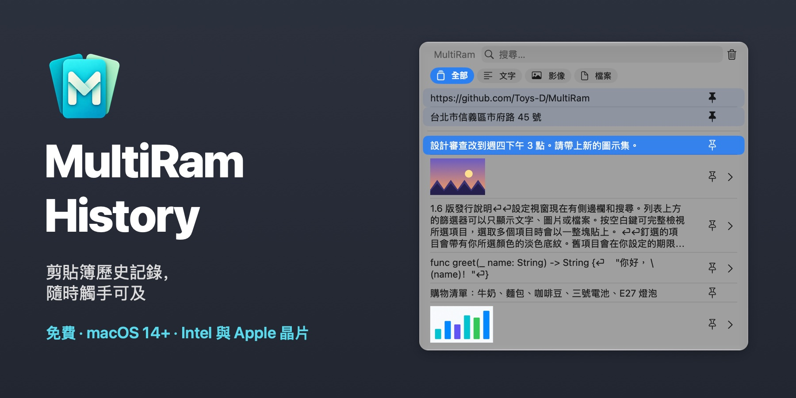
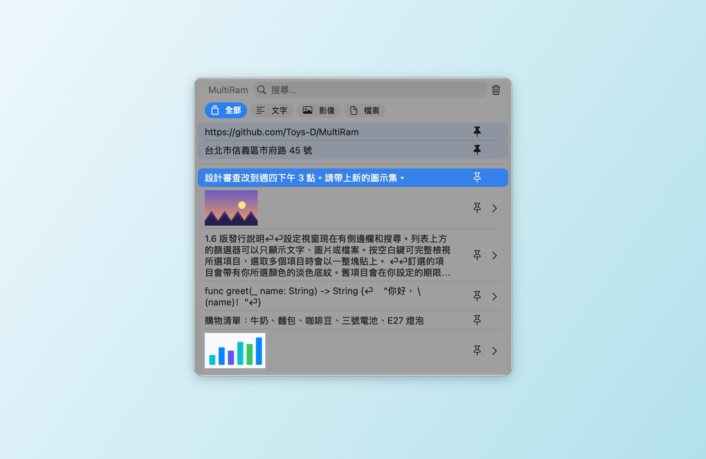
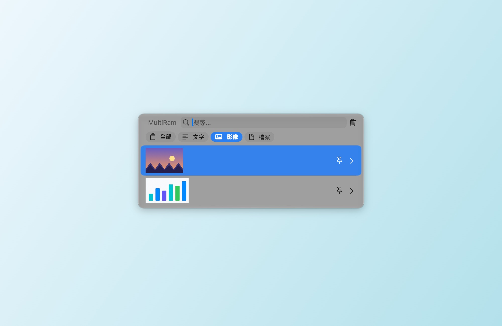
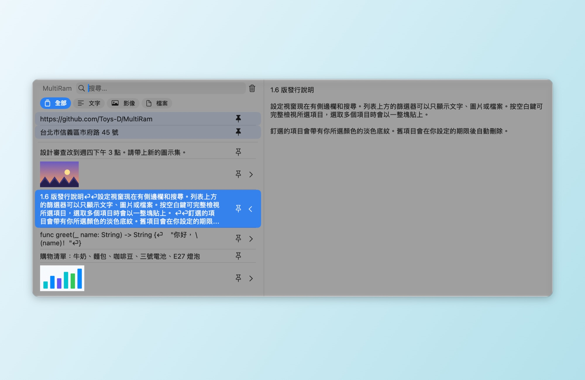
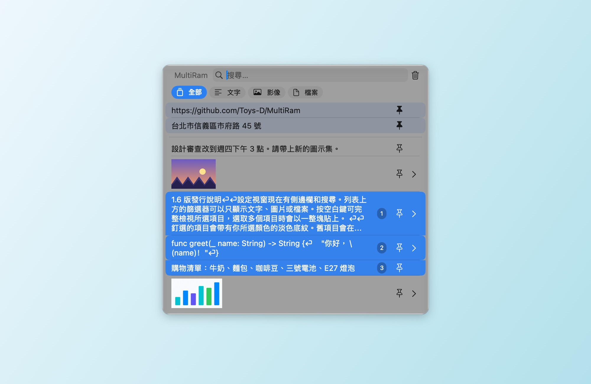
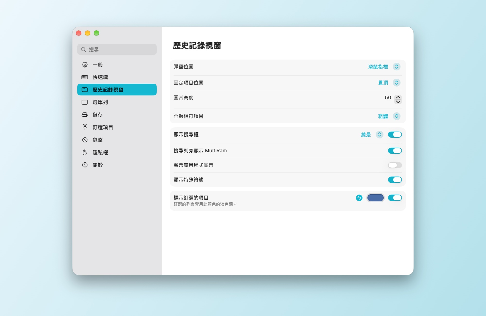
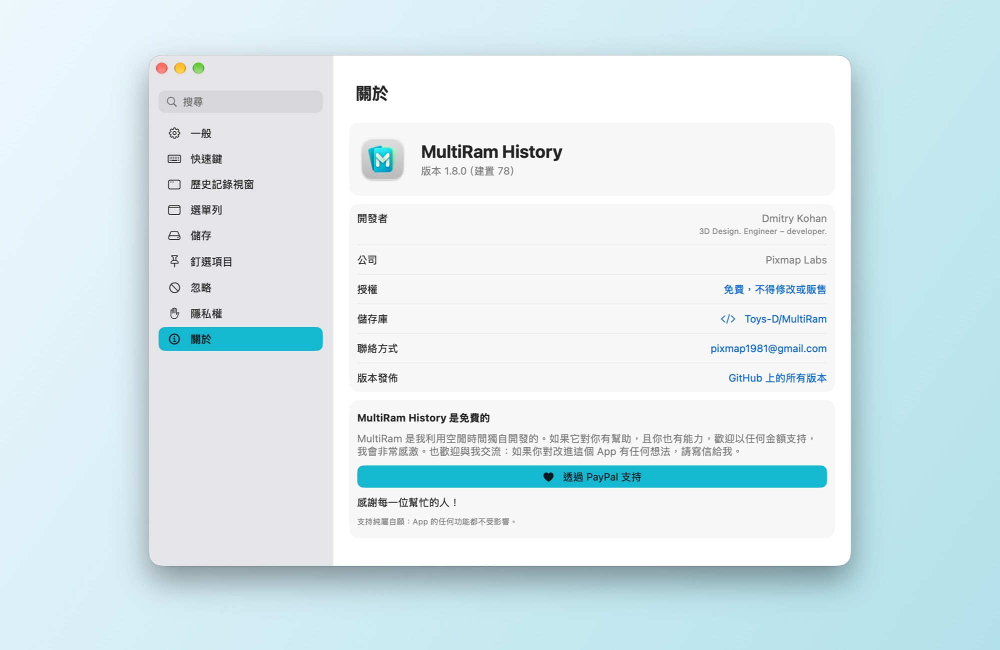

# MultiRam History

[English](README.md) · [Русский](README.md#по-русски) · [Español](README.es.md) · [Français](README.fr.md) · [Deutsch](README.de.md) · [Português](README.pt-BR.md) · [简体中文](README.zh-Hans.md) · **繁體中文** · [Українська](README.uk.md)

一款 macOS 剪貼簿歷史記錄管理工具。MultiRam 會保存你拷貝的文字、影像和檔案，一秒內就能找到其中任何一項，並將它貼回你正在工作的地方。

**[下載 MultiRam.dmg](https://github.com/Toys-D/MultiRam/releases/latest/download/MultiRam.dmg)** · macOS 14 或以上版本 · Intel 和 Apple 晶片 · 9 種語言 · 免費

| | |
|:---:|:---:|
|  |  |
| **篩選**：只看文字、影像或檔案 | **預覽**：按空白鍵或 ⌘Y 查看完整項目 |
|  |  |
| **多個項目合併貼上**：Shift+↓ 或 ⌘-按一下，然後按 Return 鍵 | **設定**：可搜尋的側邊欄，變更立即生效 |

## 隨時觸手可及

按下 **Option + V**，歷史記錄就會在游標處打開。直接輸入即可搜尋，按 **Return** 鍵將項目貼到你正在使用的 App 中，按**空白鍵**查看完整內容。在密碼欄位中，macOS 會擋下只用 Option 的快速鍵，這時按 **Control + Option + V** 一樣可以打開。

## 功能

- **記住你拷貝的所有內容**：文字、程式碼、連結、影像和檔案，保存數量由你決定。
- **幫你貼上**。選取一個項目，它就會出現在你正在使用的 App 中；也可以順便移除格式。
- **搜尋**每個項目的完整文字，不分大小寫；在俄文中，«ё» 和 «е» 視為同一個字母。
- 列表上方的**篩選器**：全部、文字、影像、檔案。
- **預覽**。按空白鍵或 ⌘Y 會在側邊面板中打開項目：顯示完整文字，或以原始尺寸顯示影像。
- **在其他 App 中打開影像**。側邊面板中的圖片下方有按鈕，對應你 Mac 上找到的編輯器：預覽程式、Photoshop、Illustrator 等。
- **釘選**。把常貼上的內容釘選起來；釘選的列會固定在最上方，並帶有你所選顏色的淡淡色調。
- **多個項目合併貼上**。用 Shift+↑/↓ 或 ⌘-按一下選取它們（數字代表順序），然後按 Return 鍵：它們的文字會合成一整段貼上，每個項目一行。
- **自動整理**。超過一天、一週、一個月、三個月或一年的項目可以自動移除；釘選的項目會保留。
- **排除**。忽略指定的 App、資料類型或符合某個模式的文字；一鍵暫停記錄。
- **更新**。MultiRam 每天會向 GitHub 查詢一次最新版本，並提供它的下載頁面。你的歷史記錄絕不會離開你的 Mac。
- **使用你的語言**：英文、西班牙文、法文、德文、葡萄牙文、中文（簡體和繁體）、俄文和烏克蘭文。MultiRam 會跟隨系統語言，或使用你在 設定 ▸ 一般 中選擇的語言；如果沒有你的語言，則使用英文。

## 支援的語言

MultiRam 已完整翻譯成九種語言：

| 語言 | 中文名稱 |
|---|---|
| English | 英文 |
| Español | 西班牙文 |
| Français | 法文 |
| Deutsch | 德文 |
| Português (Brasil) | 葡萄牙文（巴西） |
| 简体中文 | 中文（簡體） |
| 繁體中文 | 中文（繁體） |
| Русский | 俄文 |
| Українська | 烏克蘭文 |

它會跟隨 macOS 的語言，或使用你在 **設定 ▸ 一般 ▸ 語言** 中選擇的語言。如果你的 Mac 使用的語言不在此列，MultiRam 會以英文顯示。

## 安裝

1. 下載 [MultiRam.dmg](https://github.com/Toys-D/MultiRam/releases/latest/download/MultiRam.dmg)，打開它，然後將 **MultiRam** 拖到「應用程式」檔案夾。
2. 打開 MultiRam。第一次打開時，macOS 會請你允許，詳見下文。圖像會出現在選單列中。
3. 若要讓 MultiRam 幫你貼上，請在 **系統設定 ▸ 隱私權與安全性 ▸ 裝置控制和資料取用**（macOS 14–26：**輔助使用**）中開啟它。取用權限一開啟，MultiRam 就會自動重新啟動。

### 為什麼第一次打開時 macOS 會要求允許

我的 App 沒有在 Mac App Store 上架，我也不支付 Apple 每年的開發者費用（99 美元），所以 Apple 不會對它們進行公證。macOS 會在第一次打開時擋下所有這類 App，這並不代表 App 本身有任何問題。只要允許一次，之後它就會像其他 App 一樣正常打開。

**macOS 15 及以上版本：**

1. 在「應用程式」檔案夾中按兩下 **MultiRam**。macOS 會提示無法驗證此 App：請按一下 **完成**，不要按「丟到垃圾桶」。
2. 打開 **系統設定 ▸ 隱私權與安全性**。
3. 向下捲動到 **安全性** 部分。在 MultiRam 已被阻擋的訊息旁，按一下 **強制打開**（嘗試打開後，這個按鈕會保留大約一小時）。
4. 使用密碼或 Touch ID 確認，然後再按一次 **強制打開**。

macOS 會記住這個選擇。更新版本使用相同的簽署，因此這個選擇和貼上權限都會保留。

**或使用「終端機」**（適用於任何版本）：`xattr -dr com.apple.quarantine "/Applications/MultiRam.app"` 會移除「從網際網路下載」的標記，之後 MultiRam 打開時就不會再出現警告。

## 使用方式

- **打開**：Option + V，在密碼欄位中用 Control + Option + V，或按一下選單列中的 MultiRam 圖像 ▸ 顯示歷史記錄。兩個快速鍵都可以在 設定 ▸ 快速鍵 中更改。
- **貼上**：按一下項目或按 Return 鍵。按住 ⌥ 只拷貝不貼上，按住 ⇧⌘ 則貼上時不帶格式。
- **尋找**：直接輸入即可。列表上方的篩選器可以只顯示文字、影像或檔案。
- **查看**：按空白鍵（搜尋欄位為空時）或 ⌘Y，或按一下列右側的箭頭。
- **釘選**：按一下列中的釘選按鈕或按 ⌥P。按 ⌥⌫ 刪除項目。
- **一次多個**：Shift+↑/↓ 或 ⌘-按一下，然後按 Return 鍵。
- **設定**：在歷史記錄視窗中按 ⌘,（逗號），或按一下選單列圖像 ▸ 設定。左側的部分：一般、快速鍵、歷史記錄視窗、選單列、儲存、釘選項目、忽略、隱私權和關於。

## 支持這個專案

MultiRam History 是免費的。我利用空閒時間獨自開發它，因為在 Mac 上拷貝和貼上，值得擁有一份像樣的歷史記錄。如果它對你有幫助，且你也有能力，歡迎以任何金額支持：這樣我就能為它投入更多時間。我會非常感激。

**[透過 PayPal 支持](https://www.paypal.com/cgi-bin/webscr?cmd=_xclick&business=pixmap1981%40gmail.com&item_name=MultiRam+History&currency_code=USD)** · pixmap1981@gmail.com · 支持純屬自願：App 的任何功能都不受影響。

## 聯絡我

錯誤、問題、想法：**[pixmap1981@gmail.com](mailto:pixmap1981@gmail.com?subject=MultiRam%20History)**，或在 GitHub 上提交 [issue](https://github.com/Toys-D/MultiRam/issues)。我很樂意交流，也總是很高興聽到讓 App 變得更好的建議。

## 從原始碼建置

在 Xcode 16 或以上版本中打開 `MultiRam.xcodeproj`，然後執行 **MultiRam** scheme。測試：`xcodebuild -project MultiRam.xcodeproj -scheme MultiRam -testPlan MultiRam -destination 'platform=macOS' test`。發佈用的 DMG 由 `scripts/package-release.py` 建置；請參閱 [docs/release.md](docs/release.md)。

## 授權

MultiRam History 是免費的：可以在家裡和工作中使用，也可以分享原始的 DMG。不得修改、逆向工程或販售。其中部分內容以 Alex Rodionov 的 [Maccy](https://github.com/p0deje/Maccy) 為基礎，依 MIT 授權條款使用。請參閱 [LICENSE](LICENSE)。

**Dmitry Kohan · Toys-D · Pixmap Labs**
